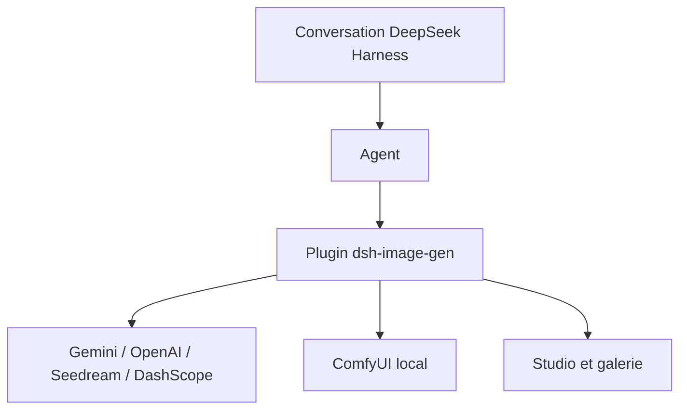

# shanliuling/dsh-image-gen

> Image generation plugin for DeepSeek Harness: batches, canvas sketches, model comparison.

## The problem
Generating several consistent images from an agent conversation means switching between tools and repeating prompts.

## What it actually does
In DeepSeek Harness, the agent plans up to ten images per message, reads a sketch or a circled area on the canvas, keeps a character consistent and searches among more than 500 prompts. Studio lets you tune parameters, compare several models and manage a gallery. Providers: Gemini, OpenAI and compatibles, Seedream, DashScope, Grok Imagine, GLM-Image, local ComfyUI. ChatGPT, Grok and Google subscriptions connect without a key.

## How it is wired
Simplified diagram based on the fiche, no diagram provided.


## Trying it
```bash
pnpm dsh plugin --profile web add dsh-image-gen@latest
dsh --profile web --dump-config
```

## Cost and gotchas
Requires stable DeepSeek Harness and Node 22.19+ or 24+. Provider keys are on you; prompts and reference images go to the chosen provider. The README admits there is no full SSRF protection on image downloads, and the gallery is stored in the browser.

## What it is not
Not a standalone image generator: unusable without DeepSeek Harness. GIF and SVG modes are supported only by some providers.

## Alternatives
No alternative named in the README.

## For you
Ignore unless you already use DeepSeek Harness: the tool is tied to that ecosystem and of little use for a data/AI profile.
