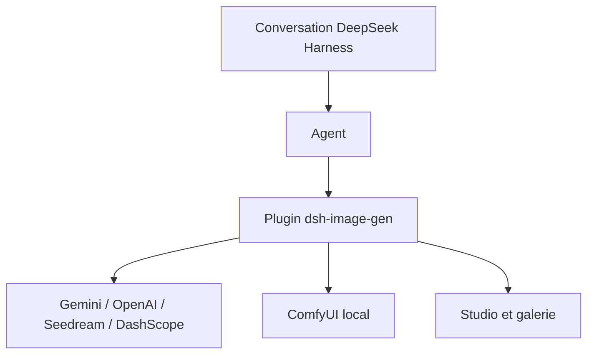

# shanliuling/dsh-image-gen

> Plugin de génération d'images pour DeepSeek Harness : lots, croquis sur canvas, comparaison de modèles.

## Le problème
Générer plusieurs images cohérentes depuis une conversation d'agent demande de passer d'un outil à l'autre et de répéter des prompts.

## Ce que ça fait vraiment
Dans DeepSeek Harness, l'agent planifie jusqu'à dix images par message, lit un croquis ou une zone cerclée sur le canvas, garde un personnage cohérent et recherche parmi plus de 500 prompts. Studio permet de régler les paramètres, de comparer plusieurs modèles et de gérer une galerie. Fournisseurs : Gemini, OpenAI et compatibles, Seedream, DashScope, Grok Imagine, GLM-Image, ComfyUI local. Les abonnements ChatGPT, Grok et Google se connectent sans clé.

## Comment c'est branché
Schéma simplifié d'après la fiche, sans diagramme fourni.


## Essayer
```bash
pnpm dsh plugin --profile web add dsh-image-gen@latest
dsh --profile web --dump-config
```

## Coût et pièges
Requiert DeepSeek Harness stable et Node 22.19+ ou 24+. Les clés des fournisseurs sont à ta charge ; prompts et images de référence partent chez le fournisseur choisi. Le README admet l'absence de protection SSRF complète sur le téléchargement d'images et la galerie se stocke dans le navigateur.

## Ce que ce n'est pas
Pas un générateur d'images autonome : inutilisable sans DeepSeek Harness. Les modes GIF et SVG ne sont pris en charge que par certains fournisseurs.

## Alternatives
Aucune alternative nommée dans le README.

## Pour toi
À ignorer sauf si tu utilises déjà DeepSeek Harness : l'outil est lié à cet écosystème et peu utile pour un profil data/IA.

