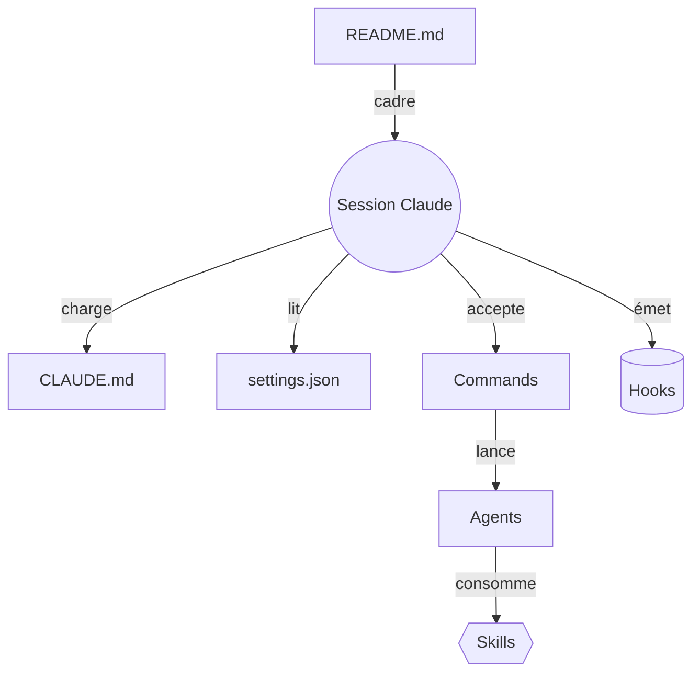

# shanraisshan/claude-code-best-practice

> Framework of best practices, models, and guidance for configuring and using Claude Code on a daily basis.

## The problem
Claude Code has a number of levers (sub-agents, skills, hooks, MCP, memory) whose official documentation provides guidance on best practices.

## What it actually does
An index of README files, organized by function (`best-practice/`, `implementation/`, `reports/`), along with community workflow tables and skill collections, and 83 sourceable tips. The `.claude/` directory serves as a chargeable example: commands, agents, skills, hooks, and rules. The reference example is the Command → Agent → Skill chain, with a weather orchestrator.

## How it is wired


## Trying it
```bash
claude
/weather-orchestrator
```

## Cost and gotchas
It's free, but you need Claude Code and an API subscription or key to use it. Third-party project star charts expire quickly, and the instructions follow specific versions of the product.

## What it is not
This is not software or a plugin to install: it is documentation and templates to copy. There is no official Anthropic source.

## Alternatives
mattpocock/skills, anthropics/skills and wshobson/agents: These are collections of pre-built skills or agents, where this repository mainly explains how to use them.

## For you
Keep an eye on this if you're using Claude Code: it's a helpful reminder, but it doesn't require any code to be executed and is maintained by a single person.
