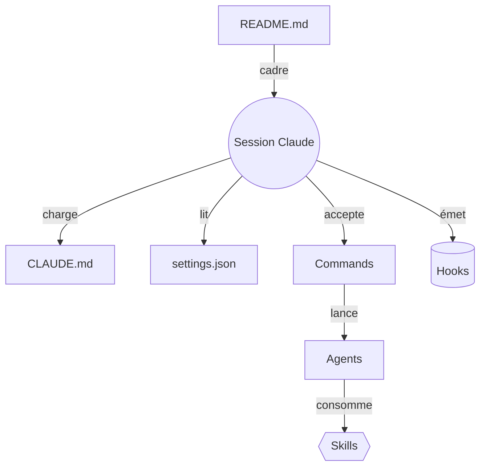

# shanraisshan/claude-code-best-practice

> Référentiel de pratiques, de modèles et de conseils pour configurer et exploiter Claude Code au quotidien.

## Le problème
Claude Code a beaucoup de leviers (sous-agents, skills, hooks, MCP, mémoire) dont la documentation officielle éparpille les bonnes pratiques.

## Ce que ça fait vraiment
Un README-index vers des guides par fonction (`best-practice/`, `implementation/`, `reports/`), des tableaux de workflows communautaires et de collections de skills, et 83 astuces sourcées. Le dossier `.claude/` sert d'exemple chargeable : commandes, agents, skills, hooks, règles. L'exemple de référence est la chaîne Commande → Agent → Skill avec un orchestrateur météo.

## Comment c'est branché


## Essayer
```bash
claude
/weather-orchestrator
```

## Coût et pièges
Gratuit, mais il faut Claude Code et un abonnement ou une clé d'API pour l'utiliser. Les tableaux d'étoiles de projets tiers se périment vite, et les astuces suivent des versions précises du produit.

## Ce que ce n'est pas
Ce n'est pas un logiciel ni un plugin à installer : c'est de la documentation et des gabarits à copier. Aucune source officielle d'Anthropic.

## Alternatives
mattpocock/skills, anthropics/skills et wshobson/agents : des collections de skills ou d'agents prêtes à l'emploi, là où ce dépôt explique surtout comment s'y prendre.

## Pour toi
À surveiller si tu utilises Claude Code : bon aide-mémoire, sans code à exécuter, tenu par une seule personne.

