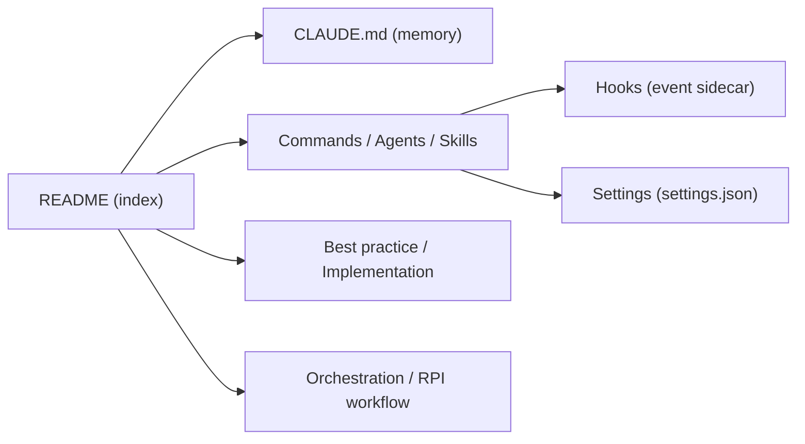

# shanraisshan/claude-code-best-practice

> Dépôt de référence sur les primitives de Claude Code, avec exemples, conseils et workflows communautaires.

## Le problème
Les fonctions de Claude Code (sous-agents, skills, hooks, MCP, mémoire) évoluent vite et les bonnes pratiques sont dispersées entre tweets, vidéos et dépôts.

## Ce que ça fait vraiment
Un index README et des dossiers `best-practice/`, `implementation/`, `reports/`, `tips/` : tableau des concepts, 83 conseils sourcés (Boris Cherny, Thariq, etc.), comparatif de workflows (Superpowers, gstack, Spec Kit…), collections de skills et d'agents. Une couche `.claude/` opérationnelle (commandes, agents, skills, hooks) montre le motif Commande → Agent → Skill avec l'exemple `/weather-orchestrator`.

## Comment c'est branché


## Essayer
```bash
claude
/weather-orchestrator
```

## Coût et pièges
Gratuit. Beaucoup de chiffres (étoiles, nombre de skills) sont des instantanés du README, déjà divergents d'un dépôt à l'autre. Plusieurs liens sont des tweets qui peuvent disparaître.

## Ce que ce n'est pas
Pas un outil à installer ni une autorité officielle d'Anthropic : une curation individuelle. Pas un benchmark : les conseils ne sont pas évalués.

## Alternatives
- Superpowers : méthode appliquée plutôt que référence.
- gstack : workflow prêt à l'emploi.
- anthropics/skills : collection de skills nommée dans le README.

## Pour toi
À adopter comme lecture de référence : un seul dépôt à parcourir pour monter en compétence sur Claude Code avant de choisir un workflow.

