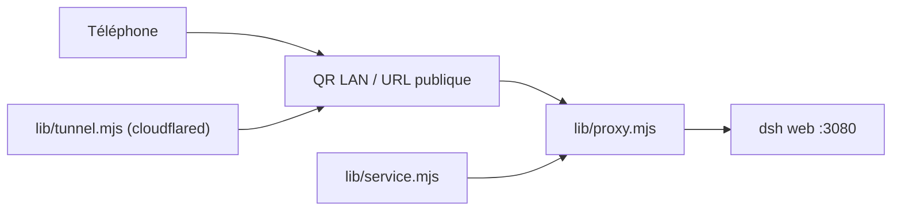

# shaobeichen/dsh-pocket

> Plugin that makes the DeepSeek Harness web interface accessible from a phone via QR code.

## The problem
The agent runs on the computer, but you can neither follow it nor approve its actions while on the move.

## What it actually does
A reverse proxy exposes the `dsh web` interface on the local network (QR code) or on the Internet through a cloudflared tunnel. 8-character passwords, attempt limiting, a named-tunnel mode with a fixed domain, compression and WebSocket passed through live. A "Mobile access" settings page drives everything.

## How it is wired


## Trying it
```bash
npm install -g @deepseek-ai/dsh
dsh plugin --profile web add dsh-pocket -w
npx @deepseek-ai/dsh web
```

## Cost and gotchas
Free. DSH executes code: opening it to the Internet is a risk that the README puts first. The Cloudflare tunnel is downloaded; Clash in TUN mode can block it (error 1033).

## What it is not
Neither guaranteed security nor remote desktop: it is a web relay, useful only with DeepSeek Harness.

## Alternatives
No alternative named in the README.

## For you
Ignore: depends on a specific agent and exposes a code executor; a personal VPN is better.
