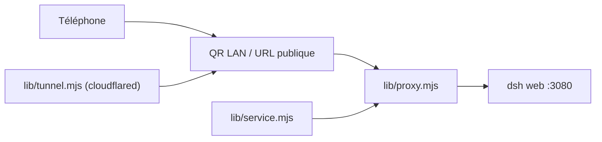

# shaobeichen/dsh-pocket

> Plugin qui rend l'interface web de DeepSeek Harness accessible depuis un téléphone par QR code.

## Le problème
L'agent tourne sur l'ordinateur, mais tu ne peux ni le suivre ni l'approuver en déplacement.

## Ce que ça fait vraiment
Un proxy inverse expose l'interface `dsh web` sur le réseau local (code QR) ou sur Internet via un tunnel cloudflared. Mots de passe de 8 caractères, limitation des essais, mode tunnel nommé à domaine fixe, compression et WebSocket transmis en direct. Une page de réglages « Accès mobile » pilote le tout.

## Comment c'est branché


## Essayer
```bash
npm install -g @deepseek-ai/dsh
dsh plugin --profile web add dsh-pocket -w
npx @deepseek-ai/dsh web
```

## Coût et pièges
Gratuit. DSH exécute du code : l'ouvrir sur Internet est un risque que le README place en tête. Le tunnel Cloudflare se télécharge ; Clash en mode TUN peut le bloquer (erreur 1033).

## Ce que ce n'est pas
Ni sécurité garantie ni bureau à distance : c'est un relais web, utile seulement avec DeepSeek Harness.

## Alternatives
Aucune alternative nommée dans le README.

## Pour toi
À ignorer : dépend d'un agent précis et expose un exécuteur de code ; mieux vaut un VPN personnel.

