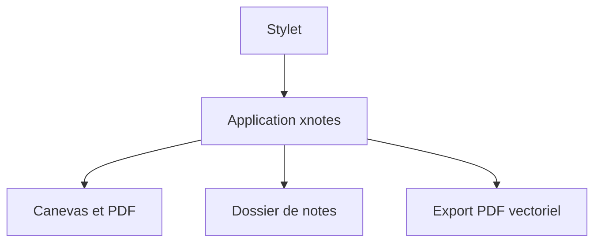

# shardulvs/xnotes-android

> Android app for ink note-taking and PDF annotation, for tablets and styluses.

## The problem
Annotating PDFs and handwriting on Android is limited by closed or locked-down apps.

## What it actually does
Pressure-sensitive ink, notes on an infinite canvas, PDF import and annotation with color filters, vector PDF export, Markdown, LaTeX, synchronized audio recording, more than 20 page templates. Notes are simple files in a folder you choose. No account, no ads, no internet access.

## How it is wired
Simplified diagram based on the sheet, no diagram provided.



## Trying it
```bash
git clone https://github.com/shardulvs/xnotes-android.git
cd xnotes-android
JAVA_HOME=/path/to/jdk-17 ./gradlew assembleDebug
```

## Cost and gotchas
Free (MIT). Signed APK on GitHub Releases, F-Droid or Google Play. Building requires JDK 17, NDK 27.0.12077973 and CMake 3.22.1. 148 open issues.

## What it is not
Not a data work tool. Android only, no cloud sync announced.

## Alternatives
No alternative named in the README.

## For you
Ignore: a mainstream note-taking app, with no link to your data or MLOps practice.
