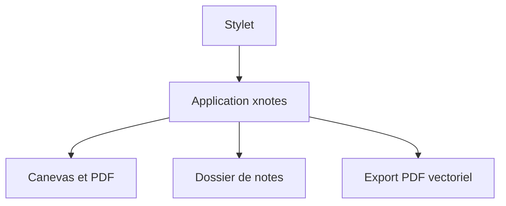

# shardulvs/xnotes-android

> Application Android de prise de notes à l'encre et d'annotation de PDF, pour tablettes et stylets.

## Le problème
Annoter des PDF et écrire à la main sur Android est limité par des applications fermées ou verrouillées.

## Ce que ça fait vraiment
Encre sensible à la pression, notes sur canevas infini, import et annotation de PDF avec filtres de couleur, export PDF vectoriel, Markdown, LaTeX, enregistrement audio synchronisé, plus de 20 modèles de pages. Les notes sont de simples fichiers dans un dossier choisi. Sans compte, sans publicité, sans accès internet.

## Comment c'est branché
Schéma simplifié d'après la fiche, sans diagramme fourni.



## Essayer
```bash
git clone https://github.com/shardulvs/xnotes-android.git
cd xnotes-android
JAVA_HOME=/path/to/jdk-17 ./gradlew assembleDebug
```

## Coût et pièges
Gratuit (MIT). APK signé sur GitHub Releases, F-Droid ou Google Play. La compilation demande JDK 17, NDK 27.0.12077973 et CMake 3.22.1. 148 issues ouvertes.

## Ce que ce n'est pas
Pas un outil de travail data. Android uniquement, pas de synchronisation cloud annoncée.

## Alternatives
Aucune alternative nommée dans le README.

## Pour toi
À ignorer : application de notes grand public, sans lien avec ta pratique data ou MLOps.

