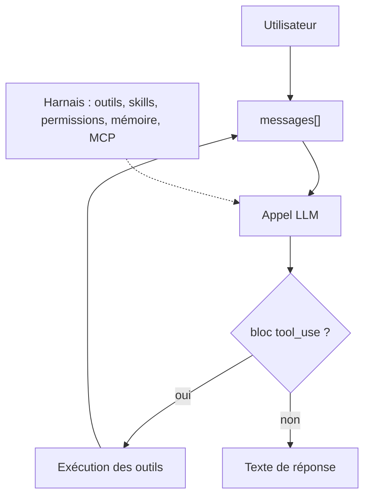

# shareAI-lab/learn-claude-code

> A 17-chapter course, downloadable and executable, covering the construction of an agent harness, starting from scratch.

## The problem
"Building an agent" is often confused with chaining API calls within a graph of nodes.

No one explains what the code actually does around the loop: the tools, the context, the permissions, and the memory usage.

## What it actually does
State a clear thesis: agency comes from training the model, not the code; your work is the framework.

There are seventeen chapters, each representing a mechanism, around a 20-line `while True` loop, which is also included in the README.

Each folder contains a README in three languages, an executable `code.py` file, and SVG diagrams.

Progress: loop, tools, permissions, hooks, to-do list, sub-agents, skills, compaction, memory, tasks,
background, cron, teams, MCP, integrated framework, workflow runtime, goal loop.

## How it is wired


## Trying it
```sh
git clone https://github.com/shareAI-lab/learn-claude-code
cd learn-claude-code
pip install -r requirements.txt
python s01_agent_loop/code.py
```

## Cost and gotchas
The course is free; running the chapters requires an `ANTHROPIC_API_KEY`, which you are responsible for providing.

Two paths coexist (the `s01-s17` root directory and the `docs/` + `agents/` directories, which have been inherited): do not mix the chapter numbers.

## What it is not
Not a library: there's nothing to import; these are self-contained educational implementations.
Not neutral: the repository promotes two proprietary products, Kode CLI and Kode Agent SDK, at the end of the learning path.
The README does not specify any license.

## Alternatives
- `affaan-m/ECC`: the inverse, a complete harness rather than an explanation of its construction.
- `Snailclimb/JavaGuide`: same course format, available as a repository, but on a completely different topic.

## For you
This is the best resource in the set for understanding what to install when installing an agent. It's worth reading.
