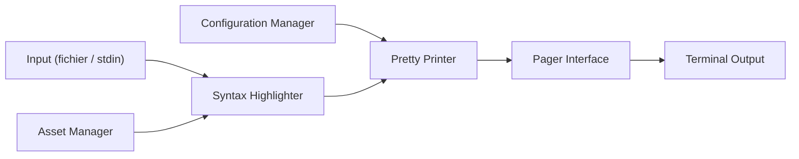

# sharkdp/bat

> A `cat` replacement with syntax highlighting and Git integration, for the terminal.

## The problem
`cat` displays files with no color, no line numbers and no indication of Git changes.

## What it actually does
Displays a file with syntax highlighting, line numbers, Git modification markers and non-printable characters. Paginates automatically (via `less`) and behaves like `cat` when the output is redirected. Themes, styles, custom syntaxes, configuration file. Combines with fzf, find, ripgrep, man, git.

## How it is wired


## Trying it
```bash
bat README.md
bat -A /etc/hosts
fzf --preview "bat --color=always --style=numbers --line-range=:500 {}"
```

## Cost and gotchas
Free. On older Debian and Ubuntu the executable is called `batcat`. The README states that `bat` is not designed for untrusted input without the `--sanitize` option.

## What it is not
Not an editor nor a full diff tool: the README points to `delta` and `batdiff`.

## Alternatives
`delta` for Git operations and diffs; `bat-extras` for companion scripts.

## For you
Adopt: immediate comfort for reading configs, logs and pipeline scripts in the terminal.
