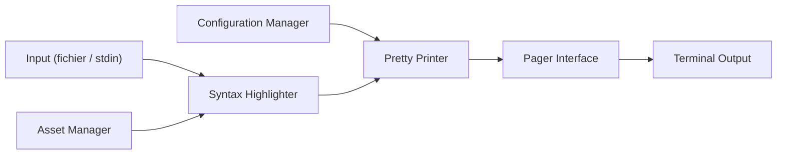

# sharkdp/bat

> Remplaçant de `cat` avec coloration syntaxique et intégration Git, pour le terminal.

## Le problème
`cat` affiche les fichiers sans couleur, sans numéros de ligne et sans indication des modifications Git.

## Ce que ça fait vraiment
Affiche un fichier avec coloration syntaxique, numéros de ligne, marqueurs de modifications Git et caractères non imprimables. Pagine automatiquement (via `less`) et agit comme `cat` quand la sortie est redirigée. Thèmes, styles, syntaxes personnalisées, fichier de configuration. Se combine avec fzf, find, ripgrep, man, git.

## Comment c'est branché


## Essayer
```bash
bat README.md
bat -A /etc/hosts
fzf --preview "bat --color=always --style=numbers --line-range=:500 {}"
```

## Coût et pièges
Gratuit. Sur d'anciennes Debian et Ubuntu l'exécutable s'appelle `batcat`. Le README déclare que `bat` n'est pas conçu pour les entrées non fiables sans l'option `--sanitize`.

## Ce que ce n'est pas
Pas un éditeur ni un outil de diff complet : le README renvoie vers `delta` et `batdiff`.

## Alternatives
`delta` pour les opérations Git et diff ; `bat-extras` pour des scripts compagnons.

## Pour toi
À adopter : confort immédiat pour lire configs, logs et scripts de pipeline en terminal.

