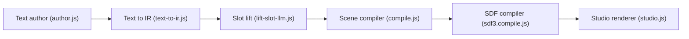

# shaun8149/sdf-js

> JavaScript library of signed distance functions and Atlas platform that generates illustrations and 3D scenes with an LLM.

## The problem
Diffusion image generation misses exact structures (clocks, diagrams, icons) and is hard to edit.

## What it actually does
An LLM (Anthropic Claude) writes SDF code from a text; seven renderers (silhouette, stipple, Pasma lines, Lambert, GPU) draw it, with background patterns and SVG export. Atlas Present turns a text into a deck of scenes assembled into a 3D world. Much of it is roadmap (M0–M7): the rules simulator is a plan, not delivered.

## How it is wired


## Trying it
```bash
cd sdf-js
python3 dev-server.py 8001
open http://localhost:8001/examples/
```

## Cost and gotchas
The LLM demos require an Anthropic API key; the README announces a key-free gallery. A license is present but not identified. The long README mixes sales pitch and real capabilities.

## What it is not
Not a delivered world simulator (M7 is on the roadmap), nor a demonstrated competitor to diffusion: these are the author's claims.

## Alternatives
fogleman/sdf (Python, from which the project derives and which is no longer maintained).

## For you
Worth watching: the idea "LLM writes geometric code" is instructive, but the project is young, from one person, and its license needs clarifying.
