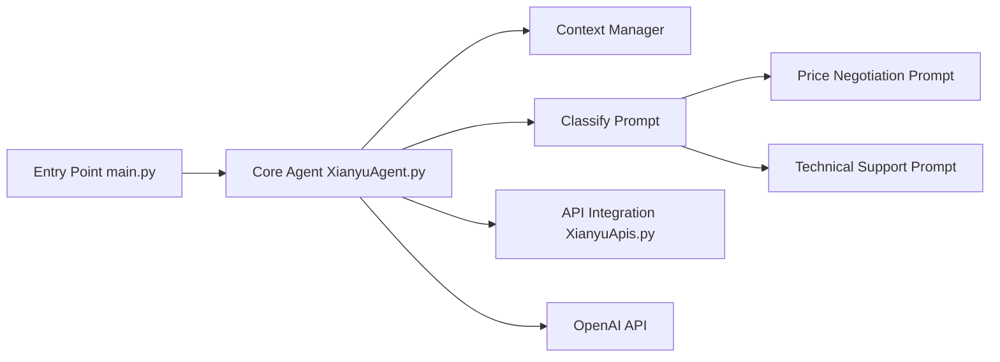

# shaxiu/XianyuAutoAgent

> LLM customer-service bot for the Chinese resale platform Xianyu, negotiation included.

## The problem
A Xianyu seller has to answer buyers day and night, negotiate prices and provide product information.

## What it actually does
Python script that connects to Xianyu with the browser's cookies, keeps the conversation history as context, classifies intent by prompt and then routes to an "expert" (price with step-by-step discounts, technical with web search, default). The experts are four editable prompt files. A keyword switches to human takeover. Qwen by default, any OpenAI-compatible model otherwise.

## How it is wired


## Trying it
```bash
git clone https://github.com/shaxiu/XianyuAutoAgent.git
cd XianyuAutoAgent
pip install -r requirements.txt
python main.py
```

## Cost and gotchas
Model key at your expense and Xianyu session cookies extracted by hand. The author warns that they may stop or delete the project at any time.

## What it is not
Not an official integration: relies on reverse-engineered Xianyu APIs (XianYuApis), "for learning" use. No RAG or web interface (announced).

## Alternatives
No alternative named; the project builds on cv-cat/XianYuApis.

## For you
Ignore: use case tied to a Chinese platform, unofficial APIs and uncertain future; only the prompt-based intent routing may serve as a simple example.
