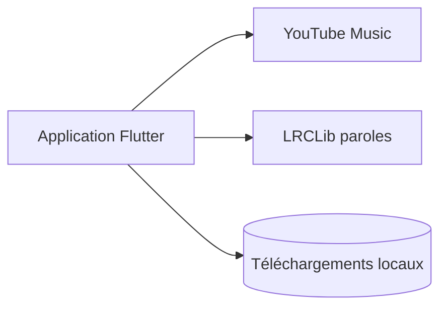

# sheikhhaziq/gyawun_music

> Flutter music player that streams YouTube Music without ads, for Android.

## The problem
Listening to YouTube Music without ads or a subscription, with downloads and background playback.

## What it actually does
Flutter app that draws on the YouTube Music catalogue: search, favourites, playlists, history, synchronized lyrics via LRCLib, equalizer, sleep timer, podcasts and offline downloads. The theme follows Material You.

## How it is wired
Simplified diagram based on the write-up, no diagram provided.


## Trying it
```bash
git clone https://github.com/sheikhhaziq/gyawun_music.git
cd gyawun_music
fvm install
fvm use
fvm flutter pub get
fvm flutter run
```

## Cost and gotchas
Free, but dependent on an unofficial YouTube Music service that can break without notice. The README reminds that the user is responsible for complying with YouTube's terms of service. 146 open issues.

## What it is not
Not a product affiliated with YouTube or Google.

## Alternatives
Not documented in the README.

## For you
Ignore: a consumer music player unrelated to data or MLOps, and its use circumvents YouTube's terms of service.
