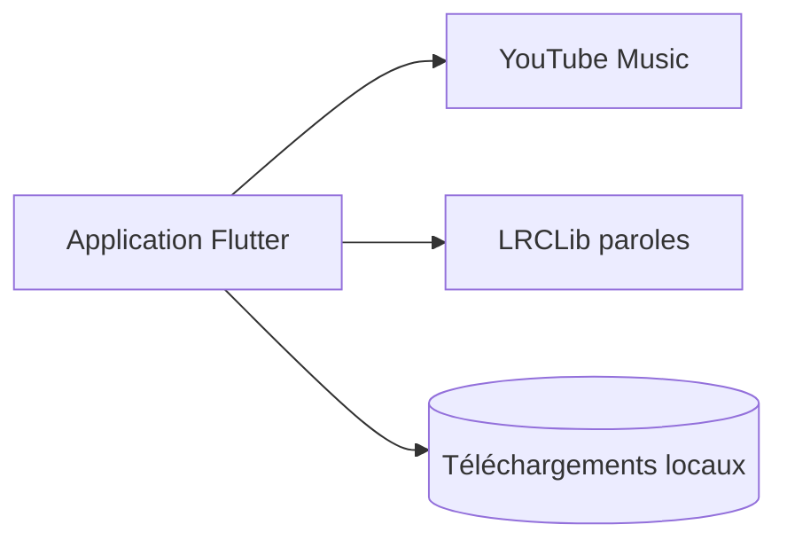

# sheikhhaziq/gyawun_music

> Lecteur de musique Flutter qui diffuse YouTube Music sans publicité, pour Android.

## Le problème
Écouter YouTube Music sans publicités ni abonnement, avec téléchargements et lecture en arrière-plan.

## Ce que ça fait vraiment
Application Flutter qui puise dans le catalogue YouTube Music : recherche, favoris, listes de lecture, historique, paroles synchronisées via LRCLib, égaliseur, minuteur de veille, podcasts et téléchargements hors ligne. Le thème suit Material You.

## Comment c'est branché
Schéma simplifié d'après la fiche, sans diagramme fourni.


## Essayer
```bash
git clone https://github.com/sheikhhaziq/gyawun_music.git
cd gyawun_music
fvm install
fvm use
fvm flutter pub get
fvm flutter run
```

## Coût et pièges
Gratuit, mais dépendant d'un service non officiel de YouTube Music qui peut casser sans préavis. Le README rappelle que l'utilisateur répond du respect des conditions d'utilisation de YouTube. 146 issues ouvertes.

## Ce que ce n'est pas
Ce n'est pas un produit affilié à YouTube ni à Google.

## Alternatives
Non documenté dans le README.

## Pour toi
À ignorer : un lecteur de musique grand public sans rapport avec la data ou le MLOps, et son usage contourne les conditions d'utilisation de YouTube.

