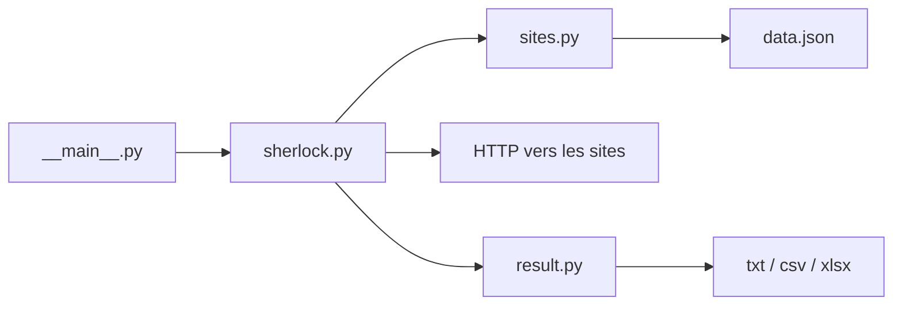

# sherlock-project/sherlock

> Command-line tool that searches for a username across more than 400 social networks.

## The problem
Finding out on which sites the same username exists requires testing each site by hand. Sherlock automates this census.

## What it actually does
- Takes one or more usernames as arguments.
- Goes through a catalog of sites (`data.json`), builds each one's profile URL and classifies the response: found, not found, ambiguous.
- Exports to a text file, CSV or XLSX; proxy, timeout and per-site filter options.
- The site catalog is separate from the engine and maintained by validation workflows.

## How it is wired


## Trying it
```bash
pipx install sherlock-project
sherlock user123
sherlock user1 user2 user3
docker run -it --rm sherlock/sherlock
```

## Cost and gotchas
Free, no API key. False positives are possible when a site changes its behavior; some third-party packages (ParrotOS, Ubuntu 24.04) are reported broken, so prefer pipx, pip, uv or Docker.

## What it is not
It is not a reliable source of identity: a username found does not prove that the account belongs to the targeted person. It involves personal data: use on others falls under the GDPR and local law, and requires a legal basis (searching on yourself, authorized audit, supervised investigation).

## Alternatives
No alternative named in the README.

## For you
Watch: useful for auditing your own online exposure or supervised open-source intelligence, but with no direct link to data / AI / MLOps work.
