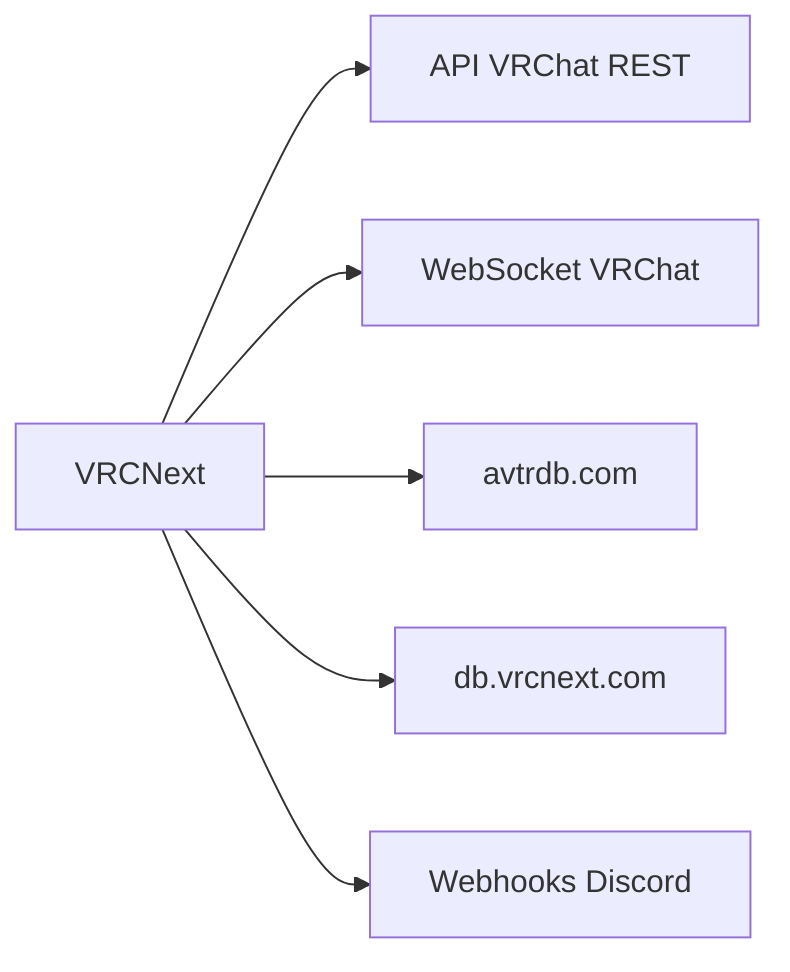

# shinyflvre/VRCNext

> Launcher and manager for VRChat: friends, worlds, avatars, photos, for VR players.

## The problem
Managing your VRChat account (friends, instances, avatars, media) requires launching the game or opening the website.

## What it actually does
Connects directly to VRChat's REST API and WebSocket. Lets you see friends and their worlds, create instances, switch avatars, manage the photo library, relay images to Discord via webhook, display a chatbox and drive OSC. Launches VRChat and other associated applications.

## How it is wired

Simplified diagram based on the sheet, no diagram provided.

## Trying it
No documented command.

## Cost and gotchas
Free, but a VRChat login is required for most features. Unsigned: Windows may flag it as a virus. Risk of VRChat moderation in case of API abuse. The README requires that you not reuse its user agent in a fork.

## What it is not
Not a cheat client and not a replacement for VRCX. Third-party avatar databases may receive information, which can be disabled. Part of the code is written with the help of an AI, according to the author.

## Alternatives
VRCX: cited by the author, who specifies that VRCNext is not a replacement for it.

## For you
Unrelated to data, AI or MLOps: ignore.
