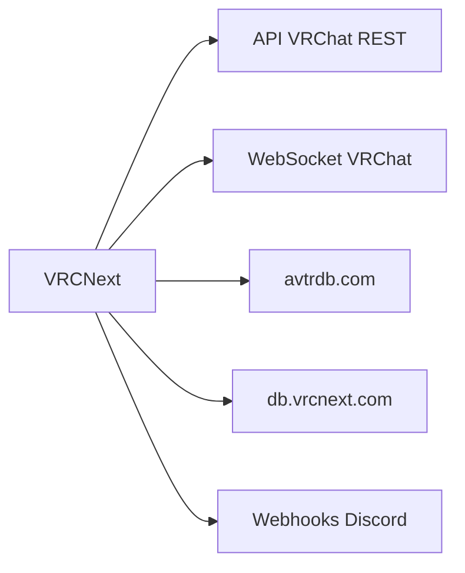

# shinyflvre/VRCNext

> Lanceur et gestionnaire pour VRChat : amis, mondes, avatars, photos, pour joueurs VR.

## Le problème
Gérer son compte VRChat (amis, instances, avatars, médias) demande de lancer le jeu ou d'ouvrir le site.

## Ce que ça fait vraiment
Se connecte directement à l'API REST et au WebSocket de VRChat. Permet de voir les amis et leurs mondes, créer des instances, changer d'avatar, gérer la bibliothèque de photos, relayer des images vers Discord par webhook, afficher une chatbox et piloter l'OSC. Lance VRChat et d'autres applications associées.

## Comment c'est branché

Schéma simplifié d'après la fiche, sans diagramme fourni.

## Essayer
Aucune commande documentée.

## Coût et pièges
Gratuit, mais une connexion VRChat est requise pour la plupart des fonctions. Non signé : Windows peut l'afficher comme virus. Risque de modération VRChat en cas d'abus de l'API. Le README impose de ne pas réutiliser son agent utilisateur dans un fork.

## Ce que ce n'est pas
Pas un client de triche et pas un remplaçant de VRCX. Les bases d'avatars tierces peuvent recevoir des informations, désactivables. Une partie du code est écrite avec l'aide d'une IA, selon l'auteur.

## Alternatives
VRCX : cité par l'auteur, qui précise que VRCNext n'en est pas un remplaçant.

## Pour toi
Sans rapport avec data, IA ou MLOps : à ignorer.

