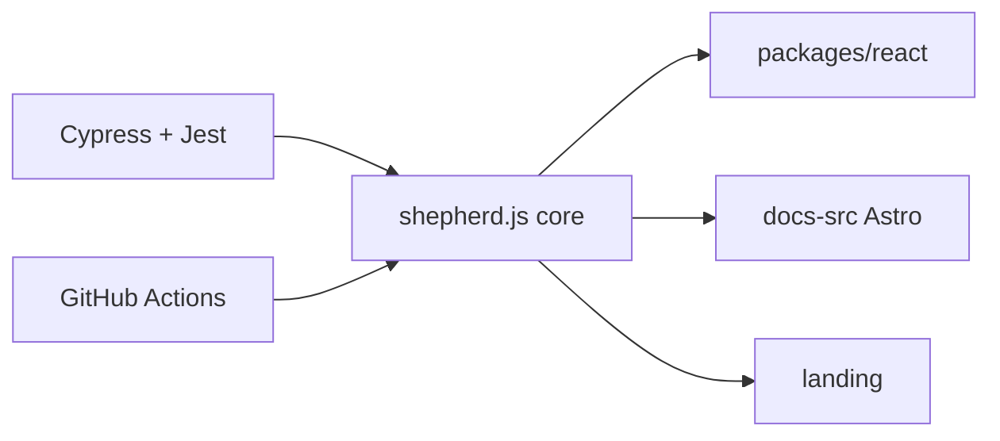

# shipshapecode/shepherd

> JavaScript guided-tour library for onboarding new users into a web application.

## The problem
New users get lost in an interface with no onboarding path.

## What it actually does
A framework-independent core library (Rollup, Babel) plus React, Angular, Vue and Ember wrappers. A pnpm monorepo with a docs site and an Astro landing page, Cypress and Jest tests. The README also mentions custom services ("White Glove Services") and a commercial license, according to the described architecture.

## How it is wired

## Trying it
No command in the README: it points to the documentation and to the wrappers' tutorials.

## Cost and gotchas
Free for the open source edition; license not identified by GitHub, read it. Angular, Vue and Ember: wrappers live outside this repository.

## What it is not
Not a product analytics tool: only tours and announcements.

## Alternatives
No alternative named in the README.

## For you
Ignore: front-end UX tool; useful only if you ship a web application to users who need guiding.
