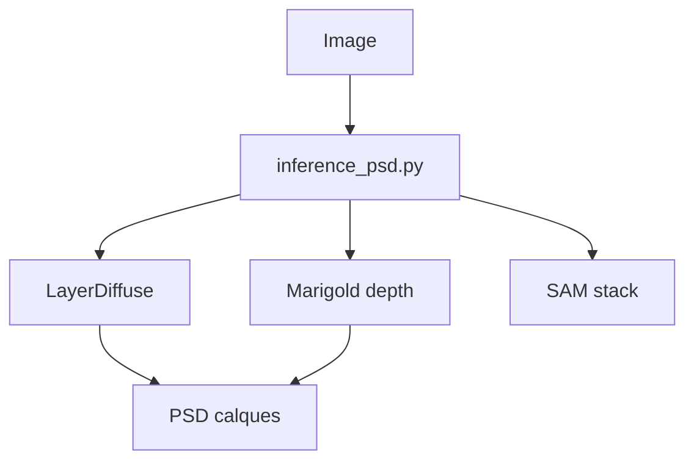

# shitagaki-lab/see-through

> SIGGRAPH 2026 research: decomposes an anime illustration into up to 23 PSD layers, for illustrators and riggers.

## The problem
Turning a still image into a 2.5D model requires manual cutting and filling in hidden areas.

## What it actually does
`inference_psd.py` combines LayerDiff 3D (SDXL, transparent layers) and a fine-tuned Marigold for depth, segments body parts and exports an ordered PSD. Low-VRAM variants (offload, NF4, block swap), training scripts, Qt interface. It is not an Image-to-Live2D tool.

## How it is wired


## Trying it
```bash
conda create -n see_through python=3.12 -y
pip install -r requirements.txt
python inference/scripts/inference_psd.py --srcp assets/test_image.png --save_to_psd
```

## Cost and gotchas
12 to 16 GB of VRAM in bf16, ~8 GB in NF4; training on 8 H200s. Models downloaded from HuggingFace.

## What it is not
Not a paid service (the README warns against paid sites). No Live2D rigging.

## Alternatives
No alternative named.

## For you
Watch: a good case of a reproducible diffusion + depth pipeline, but anime niche.
