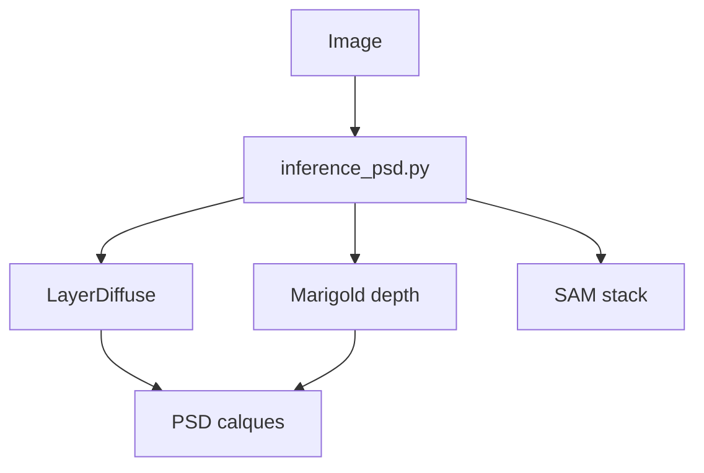

# shitagaki-lab/see-through

> Recherche SIGGRAPH 2026 : décompose une illustration d'anime en jusqu'à 23 calques PSD, pour illustrateurs et riggers.

## Le problème
Transformer une image fixe en modèle 2.5D exige un découpage manuel et le remplissage des zones cachées.

## Ce que ça fait vraiment
`inference_psd.py` combine LayerDiff 3D (SDXL, calques transparents) et un Marigold affiné pour la profondeur, segmente les parties du corps et exporte un PSD ordonné. Variantes basse VRAM (offload, NF4, block swap), scripts d'entraînement, interface Qt. Ce n'est pas un Image-to-Live2D.

## Comment c'est branché


## Essayer
```bash
conda create -n see_through python=3.12 -y
pip install -r requirements.txt
python inference/scripts/inference_psd.py --srcp assets/test_image.png --save_to_psd
```

## Coût et pièges
12 à 16 Go de VRAM en bf16, ~8 Go en NF4 ; entraînement sur 8 H200. Modèles téléchargés depuis HuggingFace.

## Ce que ce n'est pas
Pas un service payant (le README met en garde contre les sites payants). Pas de rigging Live2D.

## Alternatives
Aucune alternative nommée.

## Pour toi
Surveiller : bon cas de pipeline diffusion + profondeur reproductible, mais niche anime.

