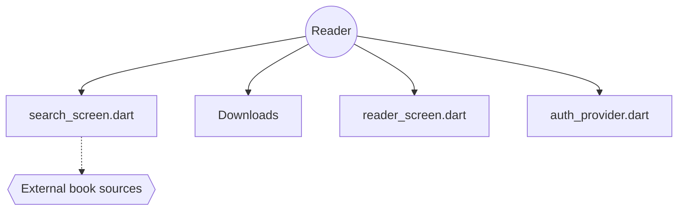

# shiyi-0x7f/olib-mobile

> Third-party Flutter ebook reading client for Android, whose data comes from unnamed external sources.

## The problem
Search, download and read books on mobile without going through the source service's official client.

## What it actually does
Flutter app (Riverpod, Hive, http package): search by title, author, ISBN or keywords, download for offline reading, dark mode, multiple accounts and multiple domains. The tree also shows WeRead screens (including an AI service), "prescriber", shelves and LAN import, but their wiring was not verified. The README states the project was built entirely with AI.

## How it is wired


## Trying it
```bash
git clone https://github.com/shiyi-0x7f/olib-mobile.git
cd olib-mobile
flutter pub get
flutter run
flutter build apk --release
```

## Cost and gotchas
Free. Flutter 3.8+, Android device or emulator. The source service and its account are not named; you depend on an external backend.

## What it is not
Not affiliated with an official service (the README says so). The origin and legality of the content are not documented. Screenshots "coming soon".

## Alternatives
None cited in the README.

## For you
Ignore: unidentified license, opaque data sources and no link with data/AI.
