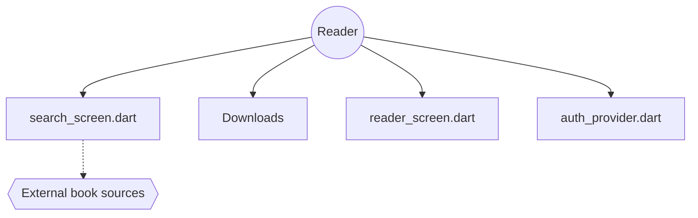

# shiyi-0x7f/olib-mobile

> Client Flutter tiers de lecture d'ebooks Android, dont les données viennent de sources externes non nommées.

## Le problème
Chercher, télécharger et lire des livres sur mobile sans passer par le client officiel du service source.

## Ce que ça fait vraiment
App Flutter (Riverpod, Hive, package http) : recherche par titre, auteur, ISBN ou mots-clés, téléchargement pour lecture hors ligne, mode sombre, multi-comptes et multi-domaines. L'arborescence montre aussi des écrans WeRead (dont un service IA), « prescriber », étagères et import LAN, mais leur câblage n'a pas été vérifié. Le README annonce un projet entièrement construit avec l'IA.

## Comment c'est branché


## Essayer
```bash
git clone https://github.com/shiyi-0x7f/olib-mobile.git
cd olib-mobile
flutter pub get
flutter run
flutter build apk --release
```

## Coût et pièges
Gratuit. Flutter 3.8+, appareil ou émulateur Android. Le service source et son compte ne sont pas nommés ; on dépend d'un backend externe.

## Ce que ce n'est pas
Pas affilié à un service officiel (le README le dit). L'origine et la légalité des contenus ne sont pas documentées. Captures « à venir ».

## Alternatives
Aucune citée dans le README.

## Pour toi
Ignorer : licence non identifiée, sources de données opaques et aucun lien avec data/IA.

