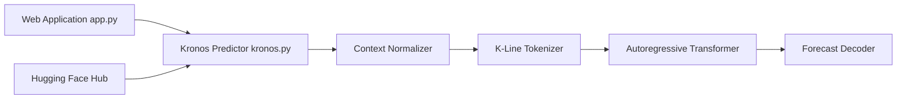

# shiyu-coder/Kronos

> Foundation model for financial candlesticks (K-lines), for quants and time-series forecasting researchers.

## The problem
General-purpose time-series models handle financial data poorly, because it is very noisy.

## What it actually does
Kronos processes OHLCV candlesticks in two steps: a tokenizer quantizes them into hierarchical discrete tokens, then an autoregressive Transformer predicts the future tokens, which are decoded into candles. Models on Hugging Face: Kronos-mini (4.1 M parameters), small (24.7 M), base (102.3 M); Kronos-large (499.2 M) is not released. `KronosPredictor` normalizes, predicts along one or several paths and denormalizes. A finetuning pipeline exists with Qlib (A-share stocks).

## How it is wired


## Trying it
```bash
pip install -r requirements.txt
pip install pyqlib
python finetune/qlib_data_preprocess.py
torchrun --standalone --nproc_per_node=NUM_GPUS finetune/train_tokenizer.py
torchrun --standalone --nproc_per_node=NUM_GPUS finetune/train_predictor.py
python finetune/qlib_test.py --device cuda:0
```

## Cost and gotchas
Free (MIT); Python 3.10+, GPU recommended and multi-GPU training with `torchrun`. Maximum context of 512 for small and base. The comments in the `finetune/` folder were AI-generated and may contain errors.

## What it is not
Not a trading system: the README speaks of a demonstration, not a strategy ready for real use. It gives no numerical results. Not pure alpha without neutralizing risk factors.

## Alternatives
- No alternative named in the README.

## For you
Keep an eye on it: a foundation model for candlesticks is a good testbed for your financial time-series forecasting, but it is a young project (created in July 2025) whose README gives no numerical results.
