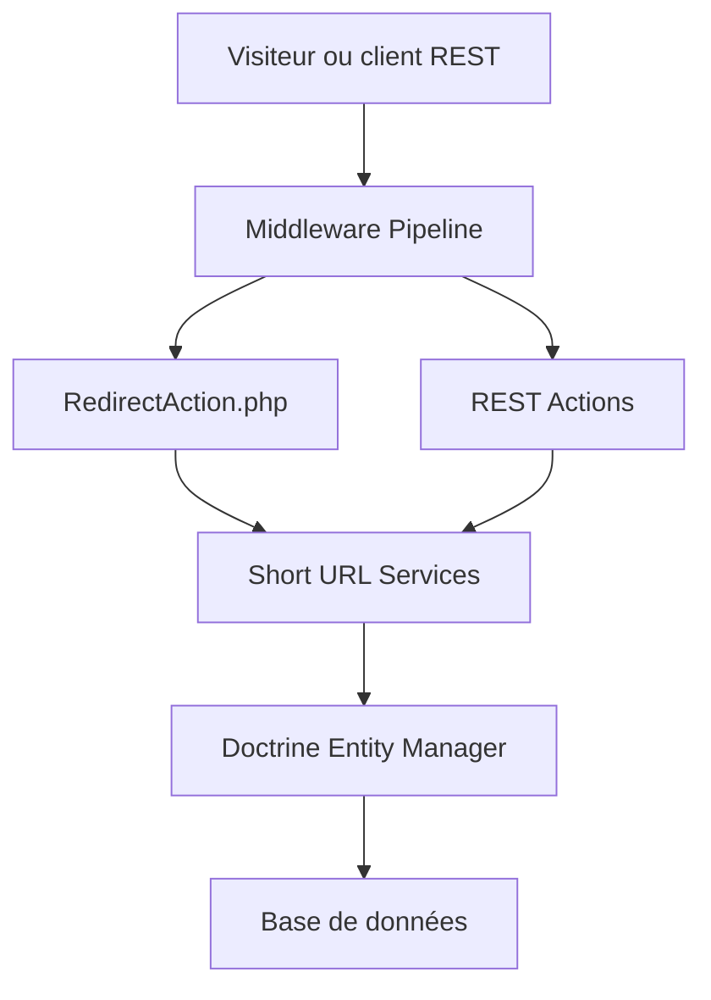

# shlinkio/shlink

> Self-hosted PHP URL shortener, under your own domain, with a REST API and command line.

## The problem
Public shorteners impose their domain and keep the visit statistics; you want your own short links.

## What it actually does
Shlink serves short URLs under your domain, applies redirection rules, tracks visits (with GeoLite2 geolocation) and manages domains, tags and API keys. You use it through the `bin/cli` CLI, the REST API or a provided web client (app.shlink.io or self-hosted). Persistence goes through Doctrine, with optional integrations (Matomo, Mercure, RabbitMQ, Redis).

## How it is wired


## Trying it
```bash
vendor/bin/shlink-installer install
bin/cli api-key:generate
bin/cli
```

## Cost and gotchas
Free. PHP 8.4 or 8.5 with several extensions, and a MySQL, MariaDB, PostgreSQL, SQL Server or SQLite database. An official Docker image is provided. Run the installer directly on the target server. API key management is done only on the command line.

## What it is not
It is not a full analytics tool. Nor is it a zero-configuration application: a database and a domain must be planned.

## Alternatives
No alternative named in the README.

## For you
Keep an eye on it: relevant for short links to your dashboards or reports, via Docker, with no direct data interest.
