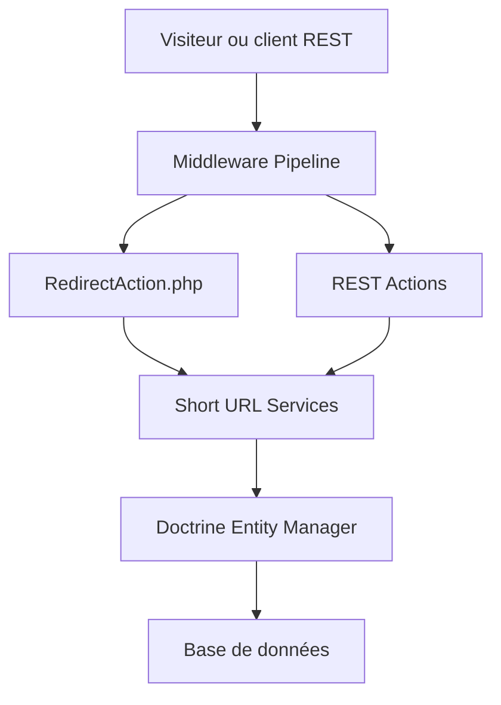

# shlinkio/shlink

> Raccourcisseur d'URL auto-hébergé en PHP, sous votre propre domaine, avec API REST et ligne de commande.

## Le problème
Les raccourcisseurs publics imposent leur domaine et gardent les statistiques de visite ; on veut ses propres liens courts.

## Ce que ça fait vraiment
Shlink sert des URL courtes sous ton domaine, applique des règles de redirection, suit les visites (avec géolocalisation GeoLite2) et gère domaines, tags et clés d'API. On l'utilise par la CLI `bin/cli`, l'API REST ou un client web fourni (app.shlink.io ou auto-hébergé). La persistance passe par Doctrine, avec des intégrations optionnelles (Matomo, Mercure, RabbitMQ, Redis).

## Comment c'est branché


## Essayer
```bash
vendor/bin/shlink-installer install
bin/cli api-key:generate
bin/cli
```

## Coût et pièges
Gratuit. PHP 8.4 ou 8.5 avec plusieurs extensions, et une base MySQL, MariaDB, PostgreSQL, SQL Server ou SQLite. Une image Docker officielle est proposée. Lance l'installeur directement sur le serveur cible. La gestion des clés d'API se fait uniquement en ligne de commande.

## Ce que ce n'est pas
Ce n'est pas un outil d'analytique complet. Il ne s'agit pas non plus d'une application sans configuration : base de données et domaine sont à prévoir.

## Alternatives
Aucune alternative nommée dans le README.

## Pour toi
À surveiller : pertinent pour des liens courts vers tes tableaux de bord ou rapports, via Docker, sans intérêt data direct.

