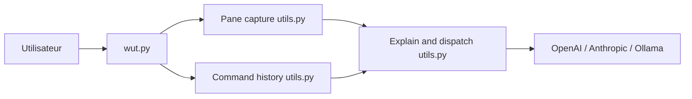

# shobrook/wut

> CLI that asks an LLM to explain the output of your last command in tmux or screen.

## The problem
An obscure error message or stack trace forces you to copy-paste into a chat to understand it.

## What it actually does
You type `wut` after a command. The tool detects the shell, captures the contents of the tmux/screen pane, retrieves the history, builds a prompt and queries OpenAI, Anthropic or a local Ollama model, then displays the answer in Markdown. A free-form question can be added.

## How it is wired


## Trying it
```bash
pipx install wut-cli
export OPENAI_API_KEY="..."
export OLLAMA_MODEL="..."
wut
wut "how do i add this to my PATH variable?"
```

## Cost and gotchas
OpenAI or Anthropic API key at your expense, or local Ollama. Works only inside a tmux or screen session.

## What it is not
Not an agent that fixes things: it explains. Without tmux/screen, it sees nothing. Last push in late 2024.

## Alternatives
No alternative cited in the README.

## For you
Watch: handy and trivial to install for everyday terminal use, but little activity since late 2024 and no strategic stakes.
