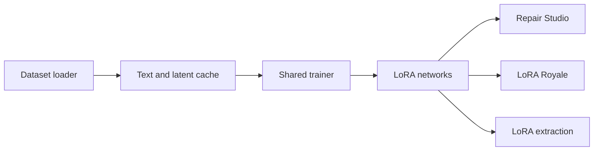

# shootthesound/Fizgig

> LoRA training and repair workshop for Flux 2 Klein, Krea 2 and MiniMax H3, on consumer GPUs.

## The problem
Training a LoRA on 16 GB of VRAM is tricky, and an overtrained LoRA cannot be fixed without restarting everything.

## What it actually does
A desktop application prepares the dataset, writes captions, and trains LoRAs (or fine-tunes the full model, experimentally) with automatic VRAM planning. After training: Repair Studio tunes each block, Explorer evolves a LoRA, Royale compares every epoch, Profiler and Extract analyze and reduce the rank. Handles photos, video clips and voice; safetensors output for ComfyUI. RunPod option.

## How it is wired


## Trying it
```bash
git clone https://github.com/shootthesound/Fizgig.git
cd Fizgig
python install_fizgig.py
./run_fizgig.sh
python -m fizgig.scripts.fetch_models --family krea2
```

## Cost and gotchas
Free, but needs an NVIDIA 30/40/50 GPU or AMD ROCm, 32 GB of RAM recommended (48 GB with previews), 40 GB of models. Full fine-tuning: checkpoints of 21 to 26 GB. Linux ROCm is very experimental.

## What it is not
Not an online service: everything runs on your machine or a rented pod. Full fine-tuning is marked experimental, NVIDIA only.

## Alternatives
The README cites ComfyUI as a deployment target, and mentions kohya, OneTrainer, AI-Toolkit and LyCORIS, whose LoRAs it can load.

## For you
Worth watching: very rich for generative image/video AI, but creation-oriented and needs a powerful GPU; little relevance to enterprise data work.
