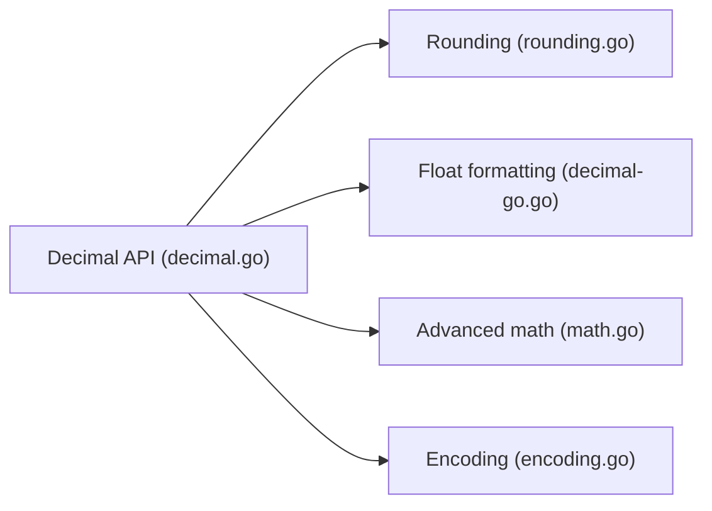

# shopspring/decimal

> Arbitrary-precision fixed-point decimal numbers in Go, for amounts and exact calculations.

## The problem
`float64` cannot represent 0.1 exactly; errors accumulate, notably with money.

## What it actually does
Immutable `Decimal` type, usable zero value, exact addition, subtraction and multiplication, division at a chosen precision, rounding, `database/sql`, JSON and XML serialization, advanced math. At most 2^31 digits after the decimal point.

## How it is wired


## Trying it
```bash
go get github.com/shopspring/decimal
```
```go
price, _ := decimal.NewFromString("136.02")
subtotal := price.Mul(decimal.NewFromInt(3))
```

## Cost and gotchas
Free. Slower and more allocation-hungry than `big.Int` (acknowledged by the author). License not identified by GitHub.

## What it is not
Not a high-performance type; you must distribute remainders yourself (dividing by 3).

## Alternatives
- cockroachdb/apd: faster, mutable API close to `big.Int`.
- alpacahq/alpacadecimal: fast, precision limited to 12 digits.
- govalues/decimal: fast, allocation-free, 19 digits.

## For you
Keep an eye on it: useful for exact monetary calculations in Go; check the license before integrating.
