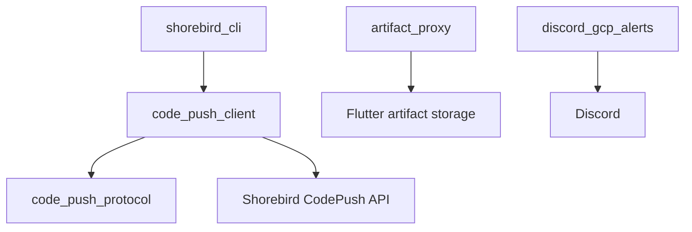

# shorebirdtech/shorebird

> Dart monorepo of Shorebird's CLI and clients, Flutter code updates without going through the stores.

## The problem
Fixing a Flutter app in production forces you back through store review.

## What it actually does
The repository contains `shorebird_cli`, the libraries `shorebird_code_push_client` and `shorebird_code_push_protocol`, `redis_client` and `scoped_deps`. According to the code diagram: also `artifact_proxy` (Flutter artifact proxy), `discord_gcp_alerts` (GCP alerts to Discord) and `jwt`. The CLI talks to Shorebird's CodePush API, hosted outside the repository.

## How it is wired


## Trying it
```bash
./scripts/bootstrap.sh
very_good test -r
```

## Cost and gotchas
The CodePush service is external (account to create); the README does not detail pricing. License present but not identified by GitHub.

## What it is not
This repository is not the service itself: the CodePush backend is not in it.

## Alternatives
No alternative named in the README.

## For you
Ignore: specific to Flutter mobile, depends on a SaaS and a license that needs clarifying.
