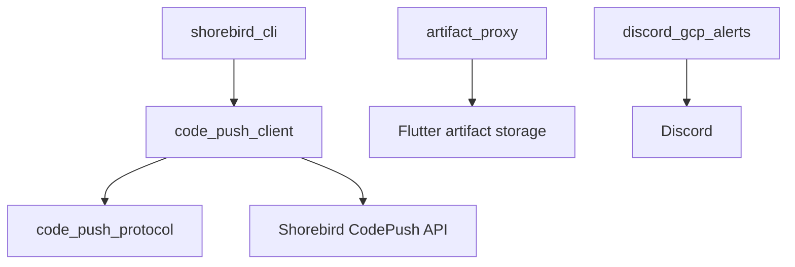

# shorebirdtech/shorebird

> Monorepo Dart du CLI et des clients de Shorebird, mises à jour de code Flutter sans passer par les stores.

## Le problème
Corriger une app Flutter en production oblige à repasser par la validation des stores.

## Ce que ça fait vraiment
Le dépôt contient `shorebird_cli`, les bibliothèques `shorebird_code_push_client` et `shorebird_code_push_protocol`, `redis_client` et `scoped_deps`. D'après le diagramme du code : aussi `artifact_proxy` (proxy d'artefacts Flutter), `discord_gcp_alerts` (alertes GCP vers Discord) et `jwt`. Le CLI parle à l'API CodePush de Shorebird, hébergée hors du dépôt.

## Comment c'est branché


## Essayer
```bash
./scripts/bootstrap.sh
very_good test -r
```

## Coût et pièges
Le service CodePush est externe (compte à créer) ; le README ne détaille pas la tarification. Licence présente mais non identifiée par GitHub.

## Ce que ce n'est pas
Ce dépôt n'est pas le service lui-même : le backend CodePush n'y figure pas.

## Alternatives
Aucune alternative nommée dans le README.

## Pour toi
À ignorer : spécifique au mobile Flutter, dépend d'un SaaS et d'une licence à clarifier.

