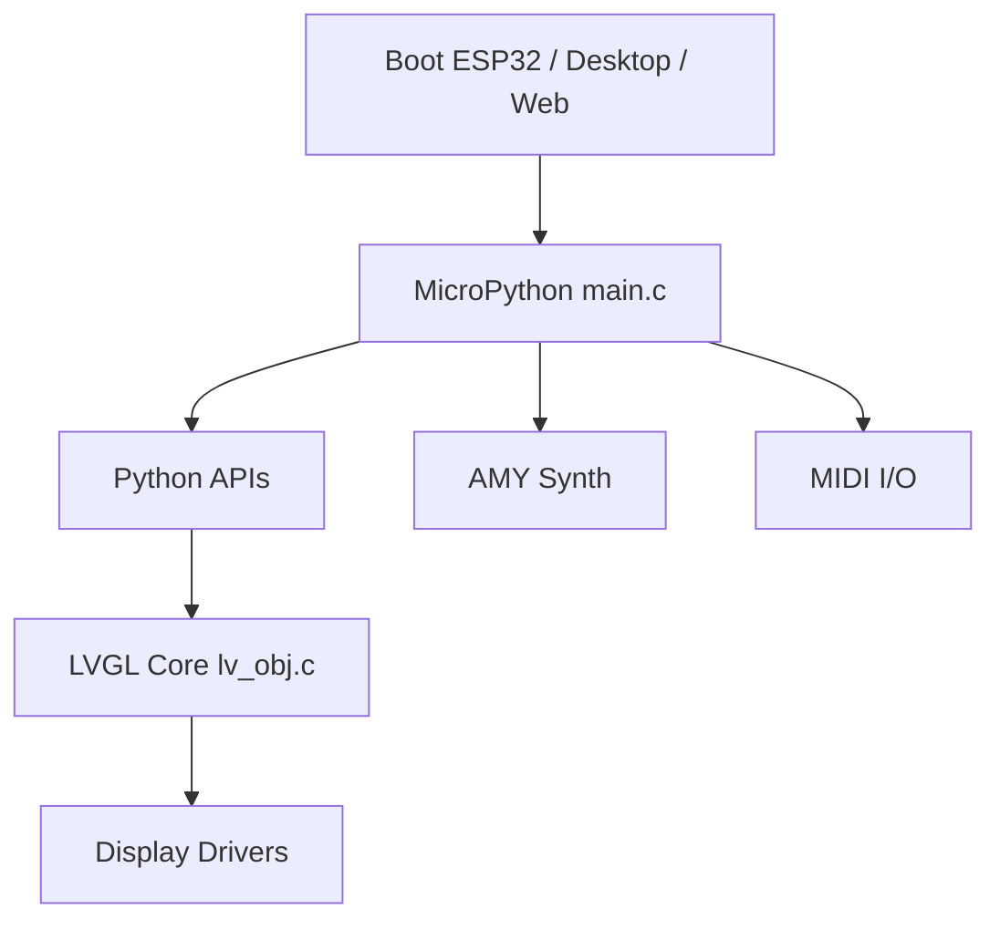

# shorepine/tulipcc

> Portable computer programmable in MicroPython on ESP32-S3, for music, graphics and creative games.

## The problem
Many computers are too complex to simply code music or graphics in real time, without distraction.

## What it actually does
A system that boots to a Python prompt with the AMY synthesizer (120 voices), hardware sprites, MIDI, WiFi and a built-in editor. It exists as hardware (Tulip CC, AMYboard), as a Desktop app for Mac/Linux and on the web.

## How it is wired


## Trying it
```bash
cd('ex')
execfile("parallax.py")
amy.drums()
```

## Cost and gotchas
The hardware is sold (Tulip 59 USD, AMYboard 29.90 USD at Makerfabs). The web or Desktop version is free. A license is present but not identified by GitHub.

## What it is not
Not a generic development tool nor an AI platform: it is an embedded creative instrument. Every function must remain equivalent between hardware and Desktop.

## Alternatives
No alternative cited in the README.

## For you
Ignore: creative and hardware project unrelated to data, AI or MLOps work, except for audio curiosity.
