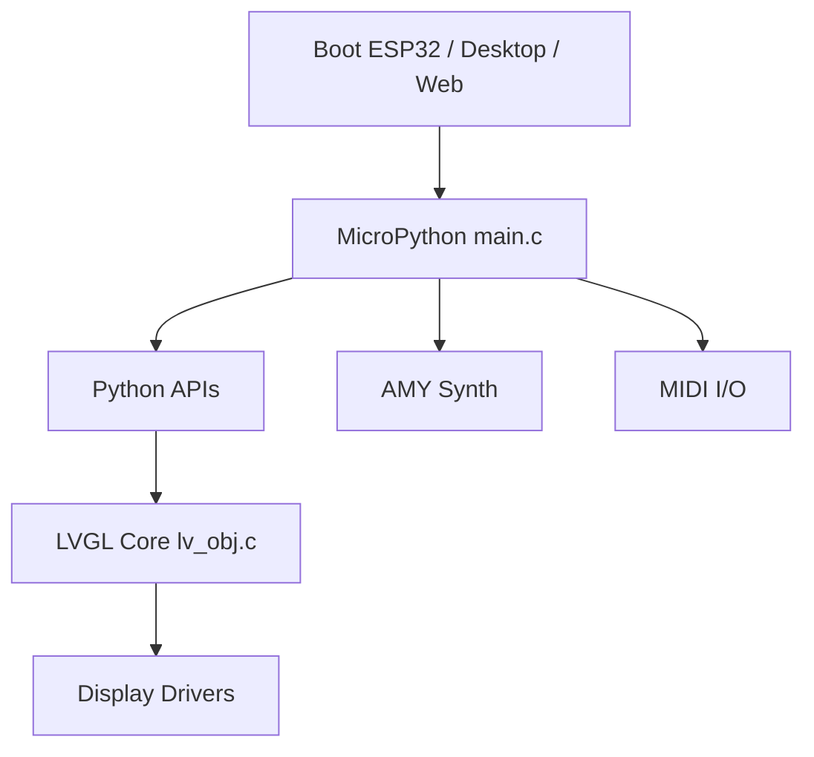

# shorepine/tulipcc

> Ordinateur portable programmable en MicroPython sur ESP32-S3, pour musique, graphismes et jeux créatifs.

## Le problème
Beaucoup d'ordinateurs sont trop complexes pour simplement coder de la musique ou des graphismes en temps réel, sans distraction.

## Ce que ça fait vraiment
Un système qui démarre sur une invite Python avec synthétiseur AMY (120 voix), sprites matériels, MIDI, WiFi et éditeur intégré. Il existe en matériel (Tulip CC, AMYboard), en application Desktop Mac/Linux et sur le web.

## Comment c'est branché


## Essayer
```bash
cd('ex')
execfile("parallax.py")
amy.drums()
```

## Coût et pièges
Le matériel est vendu (Tulip 59 USD, AMYboard 29,90 USD chez Makerfabs). La version web ou Desktop est gratuite. Licence présente mais non identifiée par GitHub.

## Ce que ce n'est pas
Pas un outil de développement générique ni une plateforme IA : c'est un instrument créatif embarqué. Toute fonction doit rester équivalente entre matériel et Desktop.

## Alternatives
Aucune alternative citée dans le README.

## Pour toi
Ignorer : projet créatif et matériel sans rapport avec le travail data, IA ou MLOps, sauf curiosité audio.

