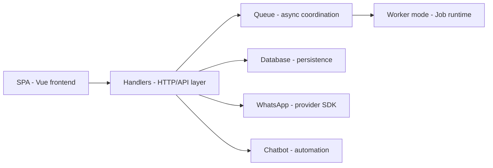

# shridarpatil/whatomate

> Self-hosted WhatsApp Business platform, as a single binary, for support teams and campaigns.

## The problem
Managing conversations, templates, campaigns and agents on the WhatsApp Business API takes several tools.

## What it actually does
A Go binary embedding a Vue 3 front end, with PostgreSQL and Redis. Multi-organization, fine-grained roles, real-time chat over WebSocket, Meta templates, campaigns with resume, chatbot (keywords, flows, AI replies via OpenAI, Anthropic or Google), voice calls and IVR. `server` and `worker` modes separate the API from asynchronous processing.

## How it is wired


## Trying it
```bash
curl -LO https://raw.githubusercontent.com/shridarpatil/whatomate/main/docker/docker-compose.yml
cp config.example.toml config.toml
docker compose up -d
./whatomate server -migrate
```
Default login `admin@admin.com` / `admin`: change it.

## Cost and gotchas
Requires a Meta Business account and the WhatsApp Cloud API (messages billed by Meta); AI provider keys if the AI chatbot is enabled. AGPL-3.0.

## What it is not
Not an alternative that avoids Meta: everything goes through the official API. Default admin password must be fixed.

## Alternatives
No alternative named in the README.

## For you
Ignore: a customer-relationship tool, outside the data/AI/MLOps scope, and with strong network copyleft.
