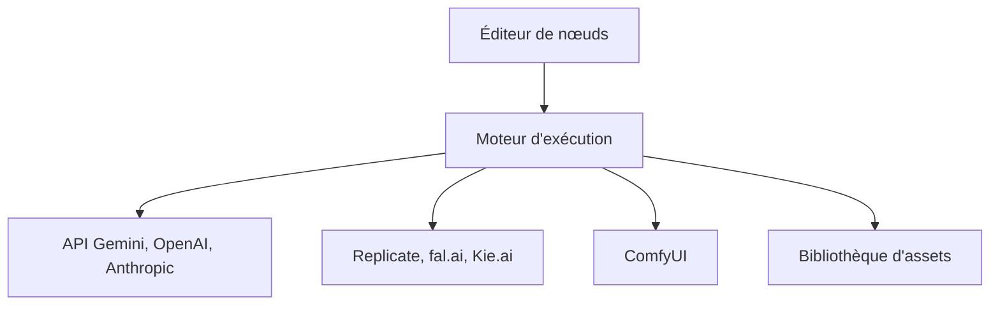

# shrimbly/node-banana

> Visual node-based workflow editor for chaining AI APIs that generate images, video, 3D and audio.

## The problem
Chaining several generative models from different providers, with dynamic prompts, quickly turns into scattered scripts.

## What it actually does
On an infinite canvas, you connect typed nodes (prompt, image generation, video, audio, 3D, LLM, annotation, router, conditional switch). The engine runs the graph according to its dependencies. It calls Gemini, OpenAI, Anthropic, Replicate, fal.ai and ComfyUI with your keys. Workflows are portable JSON files; a chat agent can build them.

## How it is wired
Simplified diagram based on the sheet, no diagram provided.



## Trying it
```bash
git clone https://github.com/shrimbly/node-banana.git
cd node-banana
npm install
npm run dev
```

## Cost and gotchas
Free, MIT, but API usage is billed by each provider. The server listens locally; do not expose it on an untrusted network. The Windows build is not signed.

## What it is not
Not a model host nor an ML tool: it orchestrates API calls. ComfyUI remains a service to install separately.

## Alternatives
- ComfyUI: the README lets you run workflows in it from Node Banana.

## For you
Worth watching: interesting for prototyping multi-model generative chains, less so for data pipelines.
