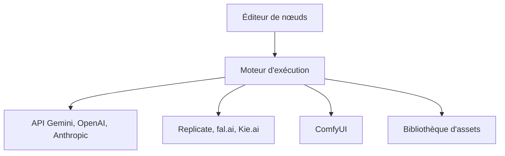

# shrimbly/node-banana

> Éditeur visuel de workflows par nœuds pour enchaîner des API d'IA générant images, vidéo, 3D et audio.

## Le problème
Enchaîner plusieurs modèles génératifs de fournisseurs différents, avec des invites dynamiques, se fait vite en scripts épars.

## Ce que ça fait vraiment
Sur un canevas infini, on relie des nœuds typés (invite, génération d'image, vidéo, audio, 3D, LLM, annotation, routeur, tri conditionnel). Le moteur exécute le graphe selon les dépendances. Il appelle Gemini, OpenAI, Anthropic, Replicate, fal.ai et ComfyUI avec tes clés. Les workflows sont des fichiers JSON portables ; un agent de chat peut les construire.

## Comment c'est branché
Schéma simplifié d'après la fiche, sans diagramme fourni.



## Essayer
```bash
git clone https://github.com/shrimbly/node-banana.git
cd node-banana
npm install
npm run dev
```

## Coût et pièges
Gratuit, MIT, mais l'usage des API est facturé par chaque fournisseur. Le serveur écoute en local ; ne l'ouvre pas sur un réseau non fiable. Le build Windows n'est pas signé.

## Ce que ce n'est pas
Pas un hébergeur de modèles ni un outil de ML : il orchestre des appels d'API. ComfyUI reste un service à installer à part.

## Alternatives
- ComfyUI : le README permet d'y exécuter des workflows depuis Node Banana.

## Pour toi
À surveiller : intéressant pour prototyper des chaînes génératives multi-modèles, moins pour des pipelines de données.

