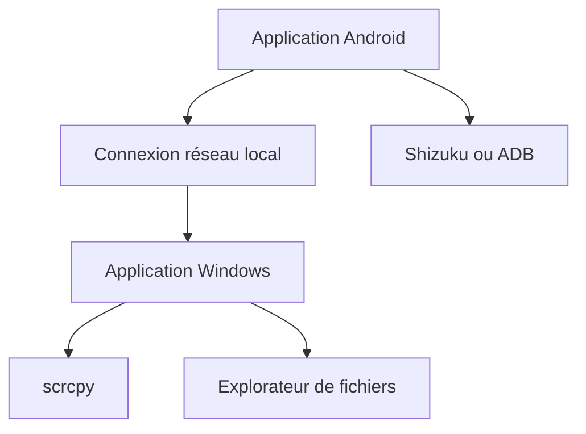

# shrimqy/Sefirah

> Syncs clipboard, notifications, files and SMS between a Windows PC and an Android phone.

## The problem
Keeping a phone and a PC in sync without a proprietary service.

## What it actually does
A Windows app and an Android app, paired over the local network with a key exchange. Clipboard sharing (automatic detection on Android 10 or later via Shizuku or ADB), media control, file transfer, Android storage in the file explorer, notifications, SMS, calls via Bluetooth, screen mirroring via scrcpy. Limited Linux support.

## How it is wired
Simplified diagram based on the sheet, no diagram provided.



## Trying it
```bash
adb shell appops set com.castle.sefirah RECEIVE_SENSITIVE_NOTIFICATIONS allow
```

## Cost and gotchas
Free. Ports 5149 to 5169 must be opened in the firewall. Android 15 hides sensitive notifications until this permission is granted. Warning: choosing the remote storage folder badly can erase the contents of an existing folder.

## What it is not
Not a data or AI tool. Android storage is described as experimental, SMS attachments are not supported.

## Alternatives
Not documented in the README (it calls itself "an alternative to existing solutions" without naming them).

## For you
Ignore: personal convenience on Windows and Android, unrelated to data, AI or MLOps.
