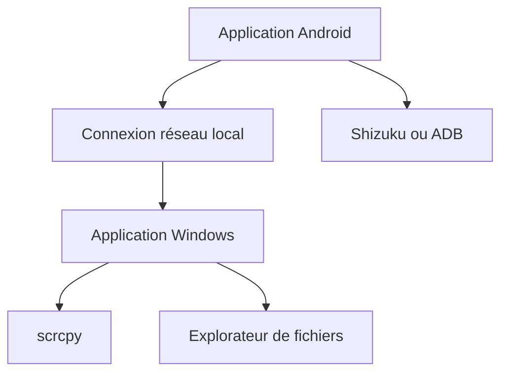

# shrimqy/Sefirah

> Synchronise presse-papiers, notifications, fichiers et SMS entre un PC Windows et un téléphone Android.

## Le problème
Garder un téléphone et un PC synchronisés sans service propriétaire.

## Ce que ça fait vraiment
Une application Windows et une application Android, appairées sur le réseau local avec échange de clés. Partage du presse-papiers (détection automatique sur Android 10 ou plus via Shizuku ou ADB), contrôle des médias, transfert de fichiers, stockage Android dans l'explorateur, notifications, SMS, appels via Bluetooth, miroir d'écran par scrcpy. Prise en charge Linux limitée.

## Comment c'est branché
Schéma simplifié d'après la fiche, sans diagramme fourni.



## Essayer
```bash
adb shell appops set com.castle.sefirah RECEIVE_SENSITIVE_NOTIFICATIONS allow
```

## Coût et pièges
Gratuit. Ports 5149 à 5169 à ouvrir dans le pare-feu. Android 15 masque les notifications sensibles tant que cette permission n'est pas donnée. Attention : mal choisir le dossier du stockage distant peut effacer le contenu d'un dossier existant.

## Ce que ce n'est pas
Pas un outil de données ou d'IA. Le stockage Android est décrit comme expérimental, les pièces jointes SMS ne sont pas gérées.

## Alternatives
Non documenté dans le README (il se dit « une alternative aux solutions existantes » sans les nommer).

## Pour toi
À ignorer : confort personnel sous Windows et Android, sans lien avec data, IA ou MLOps.

