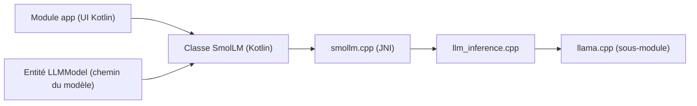

# shubham0204/SmolChat-Android

> Android application that runs small GGUF language models directly on the phone.

## The problem
Using a language model on mobile usually goes through a remote service, with data sent off the device.

## What it actually does
The application loads GGUF models with llama.cpp compiled via the Android NDK, and offers a chat with a system prompt and inference parameters (temperature, min-p). You add or remove models, and create "tasks" whose messages are not kept. Markdown rendering and code highlighting go through Markwon and Prism4j.

## How it is wired


## Trying it
```bash
git clone --depth=1 https://github.com/shubham0204/SmolChat-Android
cd SmolChat-Android
git submodule update --init --recursive
```
Then open the project in Android Studio, or install the APK from the releases, via Google Play or Obtainium.

## Cost and gotchas
Free; GGUF models must be downloaded and take up storage and memory on the phone. Computation runs on the CPU: GPU use via Vulkan is still under study according to the README. 39 open issues according to the catalog.

## What it is not
It is not a connected chat service: everything runs locally, hence limited by the device's power. It is not a reusable library as is, even though the `smollm` module is separate.

## Alternatives
No alternative named in the README (it cites other projects by the author, such as Android-Doc-QA for local RAG).

## For you
Worth watching: a clear base for understanding on-device inference with llama.cpp and JNI, useful if you port lightweight models to mobile.
