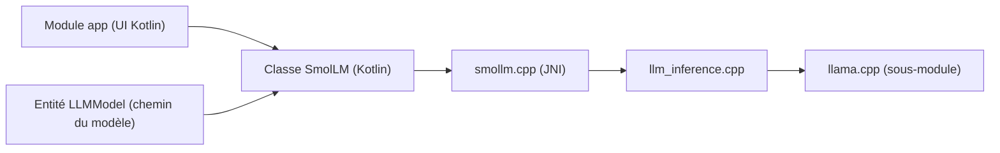

# shubham0204/SmolChat-Android

> Application Android qui exécute de petits modèles de langage GGUF directement sur le téléphone.

## Le problème
Utiliser un modèle de langage sur mobile passe d'ordinaire par un service distant, avec données envoyées hors de l'appareil.

## Ce que ça fait vraiment
L'application charge des modèles GGUF avec llama.cpp compilé via le NDK Android, et propose un chat avec prompt système et paramètres d'inférence (température, min-p). On ajoute ou retire des modèles, et on crée des « tâches » dont les messages ne sont pas conservés. Le rendu Markdown et la coloration de code passent par Markwon et Prism4j.

## Comment c'est branché


## Essayer
```bash
git clone --depth=1 https://github.com/shubham0204/SmolChat-Android
cd SmolChat-Android
git submodule update --init --recursive
```
Puis ouvrir le projet dans Android Studio, ou installer l'APK des releases, via Google Play ou Obtainium.

## Coût et pièges
Gratuit ; les modèles GGUF sont à télécharger et occupent du stockage et de la mémoire du téléphone. Le calcul se fait sur le processeur : l'usage du GPU via Vulkan est encore à l'étude d'après le README. 39 issues ouvertes d'après le catalogue.

## Ce que ce n'est pas
Ce n'est pas un service de chat connecté : tout tourne localement, donc limité par la puissance de l'appareil. Ce n'est pas une bibliothèque réutilisable en l'état, même si le module `smollm` est séparé.

## Alternatives
Aucune alternative nommée dans le README (il cite d'autres projets de l'auteur, comme Android-Doc-QA pour le RAG local).

## Pour toi
À surveiller : base claire pour comprendre l'inférence embarquée avec llama.cpp et JNI, utile si tu portes des modèles légers sur mobile.

