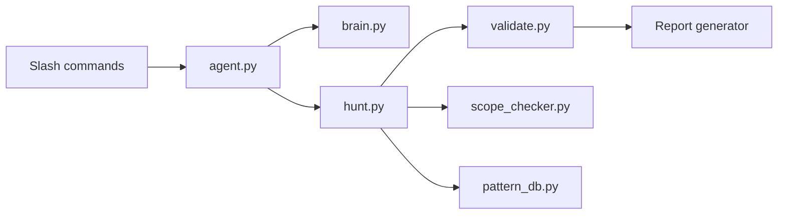

# shuvonsec/claude-bug-bounty

> CLI toolkit and Claude Code plugin that assists bug hunters in a bug bounty program.

## The problem
A bug hunter repeats the same steps (reconnaissance, testing, triage, report writing) and wastes time on findings too weak to be accepted.

## What it actually does
- Chains reconnaissance, testing, validation and reporting, via slash commands (Claude Code) or the standalone `bughunter` command.
- A 7-question "gate" discards weak findings before writing; reports target HackerOne, Bugcrowd, Intigriti and Immunefi.
- A scope checker (`scope_checker.py`) runs before testing, with an audit log, rate limiting and a circuit breaker; a memory keeps results from one session to the next.
- Nine specialized agents, an MCP server, Burp and HackerOne integrations. To be used only within the scope authorized by the program.

## How it is wired


## Trying it
```bash
git clone https://github.com/Awarexone/Agentic-Bug-Hunter.git
cd Agentic-Bug-Hunter
./install.sh --agent standalone
bughunter setup
bughunter recon target.com
bughunter validate "finding"
bughunter report
```

## Cost and gotchas
Free with Ollama locally (model of about 9 GB); otherwise an API key billed to you (Groq, DeepSeek, Claude, OpenAI...). External scanners (subfinder, nuclei, etc.) are installed separately with `install_tools.sh`.

## What it is not
Not a guarantee of bounties: the earnings ranges in the README are indicative. The repository name (shuvonsec/claude-bug-bounty) differs from the one in the README URLs (Awarexone/Agentic-Bug-Hunter), and the license is not declared. Any activity outside a program's scope is illegal.

## Alternatives
No alternative is named in the README.

## For you
Worth watching: interesting mainly for its agent patterns (scope guardrails, memory, circuit breaker); of little use to a data/MLOps profile outside bug hunting, and the license needs clarifying.
