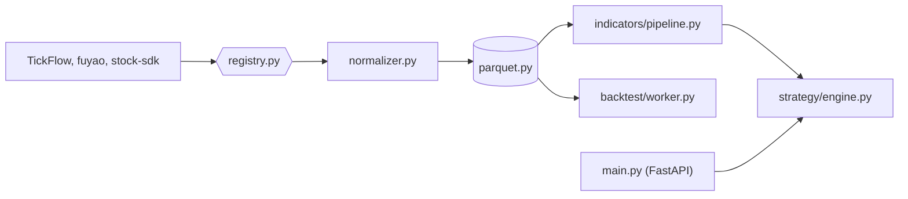

# shy3130/tick-stock-panel

> Self-hosted quant workstation for Chinese A-shares: screening, monitoring, backtesting.

## The problem
Doing quant work with scattered scripts: data source hard-coded, screening, backtesting and monitoring in tools with different conventions, the market watched by eye.

## What it actually does
A registry routes each of the 6 data families to a source that supports it (TickFlow, fuyao, stock-sdk, YAML); changing the source does not change the indicators.
Data normalized into Parquet (DuckDB for queries); a Polars pipeline derives 68 indicator and signal columns from 15 base columns.
25 built-in strategies, backtests (T+1, fees, slippage) in an isolated subprocess, factors in a DSL, out-of-sample mining.
Alerts (pop-up, voice, Feishu), an AI assistant with 18 read-only tools. FastAPI + React, a single container.

## How it is wired


## Trying it
```bash
docker run -d --name tsp -p 3018:3018 -v ${PWD}/data:/app/data ghcr.io/shy3130/tick-stock-panel:latest
cp .env.example .env
docker compose up --build
./dev.sh
```

## Cost and gotchas
Without a TickFlow key, "None" mode: free daily history only; the Free to Expert tiers unlock the rest. AI is optional via an OpenAI-compatible key. The Codex CLI mode mounts your Codex credentials into the container.

## What it is not
Not investment software nor a quotation terminal: the README rules this out, with no recommendation or prediction.
Limited to the Chinese A-share market; interface and docs in Chinese.
The author says they respond to sponsors first.

## Alternatives
No alternative named (同花顺 and 通达信 are cited as non-targets, not as repositories).

## For you
Out of scope unless you trade A-shares; the Polars + Parquet + source-routing architecture is worth a read.
