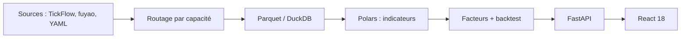

# shy3130/tickflow-stock-panel

> Self-hosted quantitative workstation for Chinese stocks: screening, backtesting and alerts.

## The problem
Quantitative tools mix data sources and conventions, making screening, backtesting and monitoring inconsistent.

## What it actually does
FastAPI + React 18 application: 25 built-in strategies, a 68-indicator pipeline with Polars, Parquet/DuckDB storage, backtests (T+1, fees, slippage), a factor and mining platform, an anomaly monitor, an AI assistant with 18 read-only tools. Data sources are plugins routed by capability (TickFlow, fuyao, stock-sdk). The README rules out any buying advice.

## How it is wired


## Trying it
```bash
docker run -d --name tsp -p 3018:3018 -v ${PWD}/data:/app/data ghcr.io/shy3130/tick-stock-panel:latest
```

## Cost and gotchas
`TICKFLOW_API_KEY` is optional (empty = free history); `AI_API_KEY` for the AI. A-shares data only. Codex CLI mode mounts local credentials into the container.

## What it is not
Not an investment tool: "study and research" use, no recommendations. Interface and documentation are in Chinese.

## Alternatives
No alternative named in the README.

## For you
Ignore unless you are interested in Chinese markets: well built, but in Chinese, on a narrow market.
