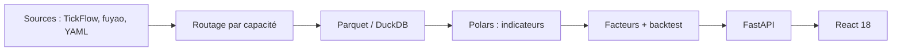

# shy3130/tickflow-stock-panel

> Poste de travail quantitatif auto-hébergé pour actions chinoises : sélection, backtest et alertes.

## Le problème
Les outils quantitatifs mélangent sources et conventions de données, rendant sélection, backtest et suivi incohérents.

## Ce que ça fait vraiment
Application FastAPI + React 18 : 25 stratégies intégrées, pipeline de 68 indicateurs avec Polars, stockage Parquet/DuckDB, backtests (T+1, frais, glissement), plateforme de facteurs et de minage, moniteur d'anomalies, assistant IA avec 18 outils en lecture seule. Les sources de données sont des plugins routés par capacité (TickFlow, fuyao, stock-sdk). Le README écarte tout conseil d'achat.

## Comment c'est branché


## Essayer
```bash
docker run -d --name tsp -p 3018:3018 -v ${PWD}/data:/app/data ghcr.io/shy3130/tick-stock-panel:latest
```

## Coût et pièges
`TICKFLOW_API_KEY` optionnelle (vide = historique gratuit) ; `AI_API_KEY` pour l'IA. Données A-shares uniquement. Le mode Codex CLI monte des identifiants locaux dans le conteneur.

## Ce que ce n'est pas
Pas un outil d'investissement : usage « études et recherche », pas de recommandations. Interface et documentation en chinois.

## Alternatives
Aucune alternative nommée dans le README.

## Pour toi
À ignorer sauf intérêt pour les marchés chinois : bien construit, mais en chinois, sur un marché étroit.

