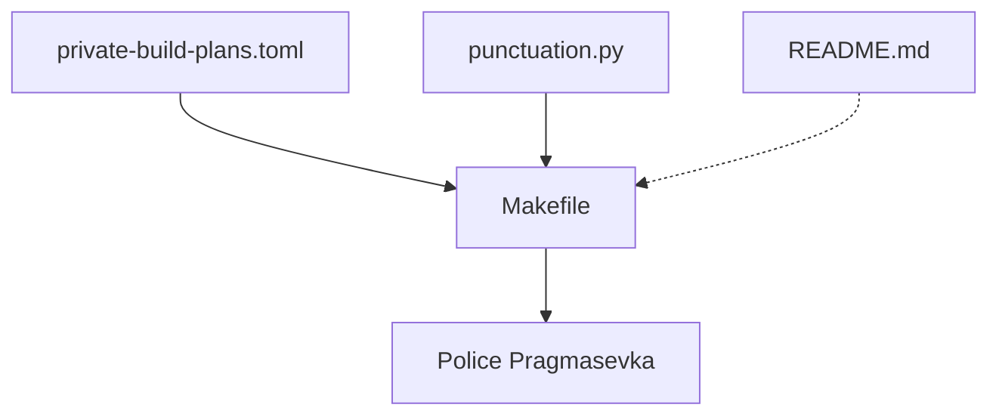

# shytikov/pragmasevka

> Monospace font derived from Iosevka, tuned to look like PragmataPro, for developers.

## The problem
PragmataPro is dense and readable but paid; Iosevka's SS08 stylistic set comes close without matching it.

## What it actually does
An Iosevka build plan (private-build-plans.toml) adjusted for x-height, line spacing, weight, punctuation and ligatures. Plain or Nerd Fonts versions available for download, or as a webfont via the npm package @aptre/pragmasevka.

## How it is wired


## Trying it
```bash
make images && make font
npm install @aptre/pragmasevka
```

## Cost and gotchas
Free, OFL-1.1. A local build requires the Iosevka tooling, not detailed. Last push in April 2025.

## What it is not
Not an exact copy of PragmataPro: the metrics are close, not identical. The dataset is a font, not data.

## Alternatives
- NRK-Mono, Iosvmata, Iosevka Tree Lig, CommitMono (cited in the README).

## For you
Ignore: terminal font choice, no effect on your data / AI work.
