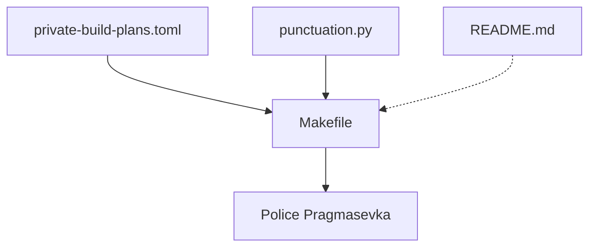

# shytikov/pragmasevka

> Police monospace dérivée d'Iosevka, réglée pour ressembler à PragmataPro, pour développeurs.

## Le problème
PragmataPro est dense et lisible mais payante ; le jeu stylistique SS08 d'Iosevka s'en approche sans l'égaler.

## Ce que ça fait vraiment
Un plan de construction Iosevka (private-build-plans.toml) ajusté en hauteur de x, interligne, graisse, ponctuation et ligatures. Versions simple ou Nerd Fonts en téléchargement, ou en webfont via le paquet npm @aptre/pragmasevka.

## Comment c'est branché


## Essayer
```bash
make images && make font
npm install @aptre/pragmasevka
```

## Coût et pièges
Gratuit, OFL-1.1. La construction locale demande l'outillage Iosevka, non détaillé. Dernier push en avril 2025.

## Ce que ce n'est pas
Pas une copie exacte de PragmataPro : les métriques sont proches, pas identiques. Le dataset est une police, pas des données.

## Alternatives
- NRK-Mono, Iosvmata, Iosevka Tree Lig, CommitMono (cités dans le README).

## Pour toi
À ignorer : choix de police de terminal, sans effet sur ton travail data / IA.

