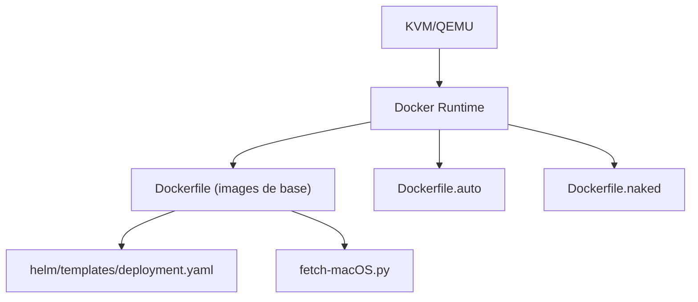

# sickcodes/Docker-OSX

> It allows you to run macOS within Docker using QEMU and KVM on a Linux x86_64 host, for testing and research purposes.

## The problem
Obtain a macOS to compile, test, or conduct security research without owning a Mac.

## What it actually does
Docker images for multiple versions of macOS (High Sierra to Tahoe), with variants `latest`, `auto` (Catalina pre-installed), and `naked` (your image). It uses QEMU and KVM, with SSH on port 50922, X11, VNC, USB passthrough, and a Helm chart for Kubernetes. The README is truncated in the source code: the rest of the documentation has not been read.

## How it is wired


## Trying it
```bash
docker run -it \
    --device /dev/kvm \
    -p 50922:10022 \
    -v /tmp/.X11-unix:/tmp/.X11-unix \
    -e "DISPLAY=${DISPLAY:-:0.0}" \
    -e SHORTNAME=catalina \
    sickcodes/docker-osx:latest
```

## Cost and gotchas
Hardware virtualization enabled, minimum 20 GB (50 GB with Xcode), `:auto` approximately 50 GB. An X11 server is required. On Windows, WSL2 with nested virtualization.

## What it is not
Not a clearly legal solution: the README redirects to a question about the legality of Hackintosh, OSX-KVM, and Docker-OSX. No GPU acceleration (listed as a TODO item).

## Alternatives
OSX-KVM (project mentioned); KVM-OpenCore; Docker-eyeOS for iOS (same author).

## For you
No connection to data/AI and unclear licensing situation for Apple: can be ignored, unless a specific need exists to build macOS.
