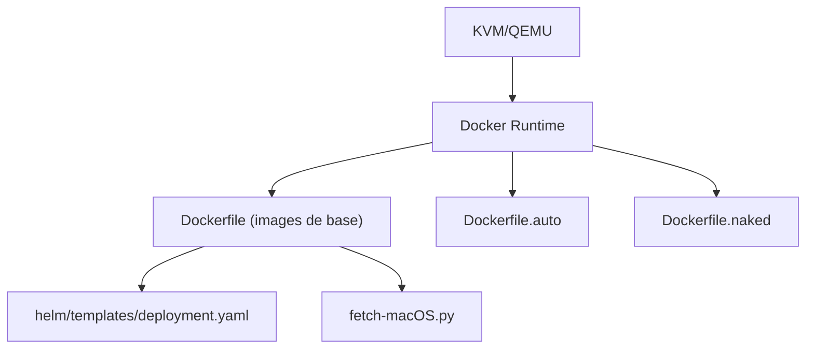

# sickcodes/Docker-OSX

> Fait tourner macOS dans Docker via QEMU et KVM sur hôte Linux x86_64, pour tests et recherche.

## Le problème
Obtenir un macOS pour compiler, tester ou faire de la recherche de sécurité sans disposer d'un Mac.

## Ce que ça fait vraiment
Images Docker pour plusieurs versions de macOS (High Sierra à Tahoe), avec variantes `latest`, `auto` (Catalina préinstallé) et `naked` (votre image). Il s'appuie sur QEMU et KVM, avec SSH sur le port 50922, X11, VNC, passthrough USB et un chart Helm pour Kubernetes. Le README est tronqué dans la source : la suite n'a pas été lue.

## Comment c'est branché


## Essayer
```bash
docker run -it \
    --device /dev/kvm \
    -p 50922:10022 \
    -v /tmp/.X11-unix:/tmp/.X11-unix \
    -e "DISPLAY=${DISPLAY:-:0.0}" \
    -e SHORTNAME=catalina \
    sickcodes/docker-osx:latest
```

## Coût et pièges
Virtualisation matérielle activée, 20 Go minimum (50 Go avec Xcode), `:auto` environ 50 Go. Un serveur X11 est requis. Sous Windows, WSL2 avec virtualisation imbriquée.

## Ce que ce n'est pas
Pas une solution légale clairement garantie : le README renvoie vers une question sur la légalité de Hackintosh, OSX-KVM et Docker-OSX. Pas d'accélération GPU (listée en TODO).

## Alternatives
OSX-KVM (projet amont cité) ; KVM-OpenCore ; Docker-eyeOS pour iOS (même auteur).

## Pour toi
Pas de lien avec la data/IA et zone grise sur la licence d'Apple : à ignorer, sauf besoin ponctuel de build macOS.

