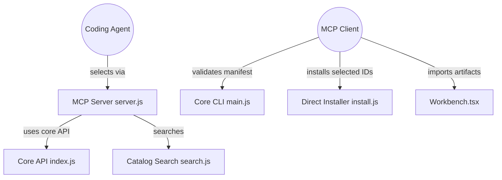

# sickn33/agentic-awesome-skills

> A library containing over 2,884 skills, in the SKILL.md format, for code agents, with a local MCP (Management and Configuration Platform) for selecting them.

## The problem
The playbooks for agents (Claude Code, Codex, Cursor, Gemini CLI) are scattered, and it's unclear which ones to install without overwhelming the system.

## What it actually does
- Provides a skills catalog in the `skills/` directory, with a machine-readable `skills_index.json` file.
- The AAS Core (MCP local + CLI `aas`) searches and reads the catalog; it's the agent that selects the IDs, and Core does not sort or recommend.
- The CLI validates an `aas-stack.json` manifest and creates an immutable snapshot; applying and restoring remain experimental features.
- A direct installer copies the selected skills from the host's directory, using the `--dry-run` option.

## How it is wired


## Trying it
```bash
npm exec --yes --ignore-scripts --package=agentic-awesome-skills@20.3.0 -- \
  agentic-awesome-skills --release 20.3.0 --path .agents/skills \
  --skills brainstorming,systematic-debugging --dry-run
```

## Cost and gotchas
Free, from MIT. Installing the entire catalog may overload the agent's context (as the README states for Antigravity). Several "official" skills listed refer to paid hosted services.

## What it is not
Not a recommender: Core does not rate anything. A structural validation does not guarantee either the suitability or the safety of a skill. Community project, not affiliated with Google.

## Alternatives
- anthropics/skills: Official Anthropic source, with a more limited scope.
- openai/skills: Official catalog from the Codex side.
- huggingface/skills: Skills specifically designed for the Hugging Face ecosystem.

## For you
Things to watch out for: Useful for acquiring specific skills, but should be used on a case-by-case basis with the `--dry-run` option, as the varying volume and source material require careful review before use.
